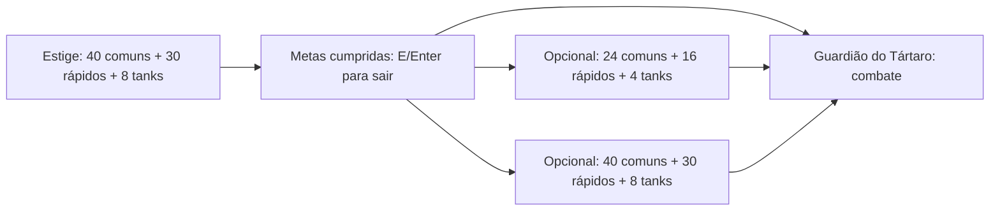

# Base da campanha

O protótipo valida profissões, geração contínua, metas de abates, transições e
combate com o chefe da primeira região. A demo de cinco minutos continua como
modo separado. O refúgio, Caronte, atributos permanentes, baús e perfil salvo já
estão no protótipo. Mini-boss, material persistente e encontro com o ferreiro
estão implementados. Outros encontros e inventário geral continuam pendentes.

## Marco 1 implementado

CombatHud atende hordas/chefe com barras compactas, metas, fase e disponibilidade
do dash. BoonPanel concentra números detalhados; XP não é arredondada pelo HUD.
GameScreen cria um marcador de saída em posição navegável após as metas, mantendo
o atalho E/Enter sem exigir proximidade. Sinais de recompensa e Fúria são contextuais.

VisibleArea usa câmera/zoom/viewport e a máscara do quadro para o corpo visível.
GameAudio.play(cue, emitter) associa uma voz ao Carrasco; stopEmitter limita o
descarte ao emissor, preservando as demais vozes. Checagem também acontece no draw.

BossEncounter tem ciclo inicial fixo, blocos embaralhados sem repetições consecutivas,
vida 500, recuperação .95/.65 e rajada 5/9. Shot captura dano no lançamento.
RunStatistics observa um modelo de chefe sem recursos GL e copia BossFightSummary
ao encerrar a sala/run, liberando a referência. Room recebe bossFight opcional;
JSON versão 1 sem esse campo permanece válido. O relatório acrescenta páginas
de métricas somente nas salas que têm esse resumo. Snapshots permanecem imutáveis.
Detalhes: [MARCO_1_LEITURA_E_CHEFE.md](MARCO_1_LEITURA_E_CHEFE.md).

## Marco 2 implementado

GameDifficulty guarda os três modos e percentuais inteiros de recompensa.
CampaignProfile tem dificuldade fixa; ProfileService.createCharacter grava uma
cópia com profissão/dificuldade antes de substituir o perfil. DifficultyScreen
mantém escolhas locais até a confirmação; cancelamento/falha não criam personagem.
Main copia o modo para RunSession, que o preserva em newAttempt.

EnemyDifficulty aceita multiplicadores positivos abaixo de 1 para Fácil.
RunSession compõe modo × escala de tempo/sala × Fúria. Almas acumulam centésimos
inteiros; Óbolos usam a soma de bases antes da conversão para inteiros.
A fração final não segue para outra tentativa. Previews de baús mostram o ganho
efetivo. RunReport registra difficulty; perfil/relatório sem campo assumem Média.
IDs, versões JSON e dados anteriores são preservados.
Detalhes: [MARCO_2_DIFICULDADES_E_ECONOMIA.md](MARCO_2_DIFICULDADES_E_ECONOMIA.md).

## Marco 3 — piloto visual implementado

PilotArt carrega um TextureAtlas nomeado sob demanda, compartilhado por Main e
descartado somente no encerramento. Fontes PNG/FNT vêm de UiTheme e pertencem
às telas. FontBaker/PilotAtlasBaker são ferramentas offline; não são runtime.
ActorAnimation conserva direção ao parar e fase ao virar, com histerese diagonal.
A expansão de 15/10/2026 acrescenta uma mistura de 0,10 s entre direções.
ExpandedArt, pertencente a PilotArt, carrega o segundo atlas uma única vez:
oito profissões (seis quadros/direção) e seis papéis de inimigo (quatro).
Cada corpo tem máscaras posicionáveis próprias e usa a direção predominante
durante a mistura; acessórios e efeitos não aumentam sua silhueta de contato.
Flecha/impacto/XP/dash e os novos golpes/poderes têm sprites, sem alterar regras.
EnemySpawner passa a referência emprestada do atlas para novos inimigos.

CaronteDialogue lê JSON por classpath; DialoguePlayback cuida da revelação,
um comando por fala, sem moeda/eventos. RefugeScreen registra a conclusão
pelo serviço de perfil existente. T alterna texto instantâneo durante esta sessão.
Base: [MARCO_3_BASE_VISUAL.md](MARCO_3_BASE_VISUAL.md).
Elenco atual: [EXPANSAO_VISUAL.md](EXPANSAO_VISUAL.md).

EquippedArt substitui a arma em camada por corpos equipados: 926 poses de origem em
64×64, disponíveis em 1.280 combinações de direção/ação. Profissões e conjuração
do chefe usam cinco direções de origem, com espelhamento horizontal das três da direita. A máscara usa alfa no recorte central de
tronco/pernas; a extensão visual da arma fica fora do contato. Jogador conserva
orientação de mira entre tiros e usa a passada real para locomover.
EncounterAnimation consulta progresso de BossEncounter/MiniBossEncounter, sem
resolver dano; TacticalVisuals desenha avisos em texturas, sem ShapeRenderer.
WeaponVisuals limita-se à rotação de efeitos/projéteis; os ícones de arma são
mostrados somente por BlacksmithScreen. DivineVisuals desenha poderes/impactos. FeedbackVisuals reutiliza os sprites para respostas a acertos.
ChestVisuals mantém apenas a cauda cosmética da abertura, limitada a seis imagens;
RunChests entrega/remove cada recompensa uma vez. BoonChoiceView concentra a
tela inteira e os retângulos dos cartões, incluindo catálogos reduzidos.
BoonPanel reutiliza os mesmos ícones. RefugeScreen usa o retrato ilustrado do
protagonista, mantendo o avanço/conclusão do diálogo no serviço existente.

## Arquitetura planejada após os playtests

O [roteiro de 13/10/2026](ROTEIRO_DE_MELHORIAS.md) prioriza HUD/áudio/Guardião,
dificuldades, base visual, catálogo/altar, Fazendeiro e acabamento da região.
As responsabilidades abaixo descrevem o sistema atual; a ampliação deverá:

- Expandir o piloto visual mantendo dano, navegação e persistência fora
  da apresentação e preservando a correspondência das máscaras.
- Definir dádivas por dados, com região de obtenção, raridade, recarga e limites;
  poderes obtidos continuam nas transições. Catalogar novas compras do altar.
- Externalizar falas/opções/condições e modelar missão do NPC do Fazendeiro com
  progresso e conclusão identificáveis. O desbloqueio compartilhado é uma proposta;
  recompensa e falhas de gravação precisam ser tratadas antes de habilitar a classe.
- Modelar troca ancinho/foice dentro da profissão, com recarga compartilhada,
  atributos da ferramenta ativa e forja única; ampliar a paginação de profissões.

HUD, visibilidade sonora e métricas entraram no M1; dificuldade/economia no M2.
O M3 incorporou fontes e o pacote piloto; a expansão antecipou parte do M6 para
todo o elenco atual. Missões, novas compras, futuros personagens e poses corporais
adicionais continuam planejadas nos respectivos marcos.

## Responsabilidades

| Componente | Responsabilidade |
| --- | --- |
| SoundCue / GameAudio / AudioBackend / GdxAudioBackend | Sons compartilhados, limites/prioridade de vozes e trilha única em streaming |
| AudioSettings / AudioSettingsStore / AudioSettingsService / AudioPanel | Volumes/mute independentes de saves, persistência/backup e edição sem avançar o combate |
| CombatFeedback / FeedbackVisuals | Pulsos limitados, cores de armas e indicação de dano/defesa/proteção baseada em resultado efetivo |
| RunSession | Modo, arena, abates, poderes, Almas pendentes, ID e métricas da tentativa |
| RunStatistics / RunReport / RunReportScreen | Agregados por sala/origem, snapshot imutável e consulta do histórico |
| SharedProgress / SharedProgressService / FileSharedProgressStore | Almas, acesso lendário e 20 relatórios; gravação global com backup |
| PlayerState | Profissão, arma, atributos, XP, vida, estamina e recargas, sem recursos gráficos |
| Profession / WeaponType / WeaponAttack | Armas iniciais, valores provisórios e geometria dos golpes de espada e socos |
| ProfessionScreen / DifficultyScreen | Pergunta do narrador e confirmação das duas escolhas na criação do save |
| GameDifficulty | Multiplicadores fixos de inimigos e percentuais das moedas elegíveis |
| SaveSlots / SaveSelectionScreen | Oito perfis independentes em duas páginas e seleção de personagem |
| EnemyType / EnemyWaves | Atributos e XP por tipo; sorteio de ondas mistas ou de um único tipo |
| ArcherAttack / WeaponVisuals | Arqueiro com aviso fixo, flechas limitadas, recuo seguro e sprites de arco/flecha; mira tática geométrica |
| FastPursuit | Ciclos de arrancada/recuperação defasados; janelas de reposicionamento sem bônus de velocidade |
| EnemyDifficulty | Escala linear de vida/dano pelo tempo total e dificuldade da sala |
| XpAttraction | Movimento e coleta dos cristais, com alcance/velocidade do ímã |
| EnemyNavigation | Campo de caminhos compartilhado, desvios e colisão do corpo |
| RegionDefinition / ArenaDefinition | Salas, metas e destinos imutáveis, carregados de JSON |
| GameScreen / Jogador | Combate, entrada, entidades, mapa e recursos gráficos da arena |
| RouteScreen | Escolha de destino entre arenas |
| BossEncounter / CombatGeometry | Máquina de estados do chefe, padrões, dano e colisão por percurso, sem OpenGL |
| SpriteHitbox / Art / ExpandedArt | Formas de alfa por quadro, posições independentes por corpo e contato/percurso vinculados à escala e direção predominante |
| ActorAnimation / PlayerAnimation / EquippedArt | Oito direções, passada/transição, equipamento incorporado à pose e máscaras do tronco/pernas |
| EncounterAnimation / TacticalVisuals | Seleção de poses e avisos animados usando os relógios e áreas dos modelos |
| WeaponVisuals / DivineVisuals / ChestVisuals | Projéteis/efeitos, poderes e abertura cosmética limitada |
| BoonChoiceView | Desenho opaco em tela inteira, ícones e retângulos compartilhados de escolha |
| ChoiceInputGuard / BoonPanel | Espera e liberação do ataque antes de escolher; consulta paginada das dádivas com tempo congelado |
| BossRoomScreen | Arena fechada, armas, poderes, avisos, HUD e resultado do combate com o chefe |
| RefugeScreen / CaronteDialogue | Área segura, conversa, altar e preparação da nova tentativa |
| CampaignProfile / PermanentBonuses | Moeda, compras limitadas, profissão e fatos; atributos iniciais da campanha |
| ProfileService / ProfileStore / FileProfileStore | Compra confirmada por gravação, retorno único, arquivo com cópia anterior |
| RunChests | Surgimento alcançável, limite de objetos e benefícios locais da arena |
| RunEncounters | Sorteio único do ferreiro e bloqueio de material por região |
| Luck / BoonRarity / UpgradeChoices | Multiplicador de sorte, categorias e três escolhas ponderadas sem repetição |
| MiniBossEncounter | Perseguição, giro, pedras, vida/dano escalados |
| WeaponRarity / BlacksmithScreen | Arma permanente no perfil e encontro seguro com compra por material |
| ArenaReward / ArenaRewardScreen | Recompensa única da sala, escolhida em segurança antes do destino |
| ArenaVariation | Pesos das hordas sorteados uma vez por sala/tentativa e anunciados na rota |

A troca de sala libera recursos gráficos e entidades locais. PlayerState continua
na mesma tentativa, sem guardar texturas ou telas. Reiniciar preserva a profissão,
mas limpa poderes, XP e contagens. Abandonar/fechar descarta o estado temporário;
o retorno guarda Óbolos e eventos no perfil. Fechar no meio da tentativa descarta
o que ainda não foi guardado. Inventário e retomada ainda não existem.

## Áudio e feedback

Main mantém o áudio por aplicação; as arenas só pedem eventos. SoundCue possui
intervalo, duração, ganho e prioridade. GameAudio expira e para a instância certa,
mantém até 8 vozes e privilegia avisos sobre ataques/coleta. Transição descarta
vozes e ajusta uma única trilha; Main.dispose libera os recursos compartilhados.
Sons usam Sound; loops usam Music em streaming. Falha de dispositivo não interrompe o jogo.

AudioPanel é embutido em GameScreen/BossRoomScreen, com retorno antes de avançar
a simulação. Não troca/dispose a arena, não modifica estado de pausa/boons e
não avança ChoiceInputGuard. AudioSettingsScreen atende menu/refúgio.
Ajustes atualizam vozes/música; gravação de arraste ocorre ao soltar. O arquivo
de áudio é separado, com backup e preservação de formatos não reconhecidos.

CombatDefense.Observer informa bloqueio, dano efetivo e revide após o cálculo,
sem decidir dano. CombatFeedback recebe esses eventos, ataques/acertos, dash/XP
e ressurreição; mantém até 96 pulsos com prioridade e limite de rastros.
FeedbackVisuals desenha só formas/rótulos. Colisão, navegação e câmera são preservadas.
Documentação e origem dos WAVs: [AUDIO_E_FEEDBACK.md](AUDIO_E_FEEDBACK.md).

## Exclusão e identidade do personagem

SaveSelectionScreen oferece Excluir por cartão e modo DEL + 1–4, com modal de
confirmação que bloqueia seleção e troca de página. Main.deleteSave preserva
primeiro a migração lendária, quando necessária, e chama ProfileService.reset.
FileProfileStore.reset grava um perfil vazio completo em arquivo temporário,
invalida o backup antigo e substitui o principal. Se a substituição falhar,
tenta restaurar o backup; a memória só recebe o perfil vazio após o commit.
Não há exclusão recursiva ou alteração de outros slots/arquivo compartilhado.

CampaignProfile.characterId e RunReport.characterId identificam o personagem,
com campo opcional para compatibilidade dos arquivos versão 1. prepareRun vincula
a tentativa antes de iniciar o combate, inclusive na demo. R e RunReportScreen
filtram slot + identidade. Reiniciar a run/forjar/comprar conserva a identidade;
esvaziar o slot cria outra, evitando atribuir relatórios antigos ao novo personagem.
Sair da seleção após excluir o save ativo retorna ao menu se ele ficou vazio.

PlayerState.tryShoot respeita a recarga e permite atacar com a defesa ativa;
guard, bloqueio, estamina, movimento e dash conservam suas regras.
As arenas de hordas e chefe usam o mesmo caminho de ataque.

## Profissões iniciais

| Profissão | Vida base | Velocidade base | Arma | Dano base | Intervalo base | Ataque |
| --- | --- | --- | --- | --- | --- | --- |
| Caçador | 100 | 60 | Arco | 5 | 0,65 s | Flecha a 300 unidades/s |
| Ferreiro | 130 | 54 | Espada | 8 | 0,60 s | Cone de 110°, alcance de 36 unidades; pode atingir vários inimigos |
| Vigilante | 85 | 66 | Pistola | 2 | 0,25 s | Projétil menor a 420 unidades/s |
| Apostador | 110 | 62 | Socos | 4 | 0,30 s | Cone de 80°, alcance 24; um alvo por ataque, sorte 4× |

Todos miram com o mouse e atacam segurando o botão esquerdo. Dádivas de dano,
vida e velocidade somam percentuais às bases da profissão; dano é float até a
aplicação no alvo, preservando ganhos pequenos da pistola. Cadência modifica a
taxa base, calculando intervalo = intervaloBase / (1 + bônus). Compras permanentes
usam as mesmas bases. Tabelas: [BALANCEAMENTO_E_SAVES.md](BALANCEAMENTO_E_SAVES.md). Espada e socos verificam estruturas entre jogador
e alvo; projéteis verificam o percurso para evitar atravessar paredes em um quadro.
O narrador pergunta a profissão somente na criação do save; CampaignProfile e
ProfileService impedem alterações posteriores. As escolhas ainda não mudam
diálogos posteriores. Nomes e valores precisam de playtests. Os corpos atuais
são distintos por profissão, com arma integrada e poses de ataque. Atlas e efeitos
são compartilhados; poses de dano/morte continuam pendentes.
[Revisão de animação](ANIMACOES_E_EQUIPAMENTOS.md) e
[polimento vigente](POLIMENTO_VISUAL_E_REFUGIO.md).

PlayerAnimation separa caminhada (0,135 s/quadro), respiração (0,40 s/quadro),
ataque (0,20–0,48 s por sequência) e mistura de poses (0,08 s). Não resolve disparos:
PlayerState mantém os ataques/s reais. Jogador.update(delta,map,false) permite
movimento no refúgio sem consumir disparo ou animar ataques. Durante seus painéis,
Jogador.idle(delta) apenas anima o repouso. Caronte/altar/travessia usam 12 regiões
no atlas compartilhado; ProfessionScreen também usa o repouso animado.

## Interface e geometria de combate

PlayerState.attacksPerSecond usa 1/intervaloAtual; a previsão da próxima Celeridade
respeita bônus de forja e mínimo da arma sem alterar o jogador. Tab e profissões
mostram ataques/s. Atributos de movimento conservam seus valores e percentuais.

ChoiceInputGuard bloqueia cada seleção por 1,5 s e exige soltar o ataque após a
espera. GameScreen reinicia o bloqueio ao abrir cada nível pendente; ArenaRewardScreen
aplica a mesma regra às dádivas extras. Tempo de leitura é tempo de interface:
não avança RunSession. BoonPanel consulta os ranks existentes, com páginas de seis
entradas, sem reroll ou alterações. Tab abre/fecha e Esc fecha o painel; a tela
anterior continua no mesmo estado. Nenhuma simulação ou espera de escolha avança
durante a consulta, inclusive na arena do chefe.

Art lê alfa uma vez por atlas e guarda máscaras de 64×64 de seus quadros de atores.
O cache usa chaves fracas sem conservar texturas nos valores. SpriteHitbox coloca a
máscara no mesmo retângulo e espelhamento do desenho. Contato usa limites baratos
e testa opacidade só para pares próximos; projéteis amostram o segmento completo
com seu raio. As telas fornecem a sobreposição corporal aos modelos dos encontros,
preservando as geometrias dos ataques especiais. Colisão de paredes segue em
EnemyNavigation/TileMap.

CombatEffects aplica a maldição ao alvo e vizinhos com linha livre até raio 32,
inclusive se o dano direto eliminar o primeiro alvo. Cada aplicação captura
60% de PlayerState.dps por segundo, 3/5 s, e reaplicações preservam o maior DPS.
O efeito não se propaga a partir dos vizinhos nem produz novos procs.

## Geração e experiência

| Inimigo | Vida base | Velocidade | Dano de contato base | XP por derrota |
| --- | --- | --- | --- | --- |
| Comum | 10 | 30 | 8 | 1 |
| Arqueiro (COMMON) | 14 | 28 | 6; flecha 10 | 3 |
| Rápido | 6 | 70 por 1 s / 24 por 1 s | 6 | 2 |
| Tank | 30 | 22 | 16 | 5 |

PlayerState.xpGain centraliza o multiplicador de coleta, usado por cristais e
baús. Sabedoria de Atena aplica ATHENA_XP_BONUS = 1,5, somado à base 1:
2,5×, Épica, rank máximo 1. O limite é validado por RunSession e remove a dádiva
de UpgradeChoices após a compra. A curva conserva requisito inicial 10 e
floor(requisitoAnterior ×1,5); XP acumulada não é recalculada ao obter Atena.
Frações permanecem no estado; barra no HUD e números em Tab. RunChests anuncia o ganho efetivo;
o mini-boss anuncia o cristal disponível, cujo bônus depende do momento da coleta.
Uma nova tentativa reinicia o multiplicador, sem migração de perfil.
RunReport aceita as até três escolhas históricas de Atena, para preservar a leitura
do histórico e do saldo de Almas anteriores. Esse limite histórico não permite
compras extras nas novas tentativas. A categoria mostrada no relatório segue o
catálogo atual; relatórios antigos não guardavam um snapshot da raridade da dádiva.
ExperienceBalanceTest compara escolhas úteis após pagar Atena nas metas do JSON,
com obtenção cedo/tarde, sorte, Fúria, moedas e continuidade/reset. O smoke gráfico
verifica a escolha real, frações dos cristais e a proteção do nível extra.
Cenários: [BALANCEAMENTO_E_SAVES.md](BALANCEAMENTO_E_SAVES.md#sabedoria-de-atena-e-a-curva-de-xp).

O rápido tem menos vida, mas persegue mais depressa e exige mais reação.
O tank demanda mais dano e tem contato mais perigoso. A ponderação de XP é inicial.

EnemyDifficulty usa minutos totais da tentativa (t) e difficultySeconds / 60 (s):
vida = vidaBase × (1 + 0,06t + 0,12s); dano = danoBase × (1 + 0,03t + 0,06s).
A curva não é limitada aos cinco minutos da demo e o relógio continua entre salas.
Inimigo recebe um snapshot ao nascer; o chefe, ao entrar em sua sala. Ferir um
inimigo e esperar não recalcula sua vida nem desfaz o dano. XP, velocidade e
comportamento não são multiplicados. A escala da demo usa s = 0.

Ondas têm 35% de chance de usar um único tipo; as demais sorteiam cada membro.
Na campanha, todos os tipos podem aparecer desde o início, com pesos 50%, 35%
e 15% para comum, rápido e tank. A demo preserva a introdução gradual dos tipos. Estes são pesos brutos;
EnemyWaves limita rápidos a 2 por onda e 24 ativos, redistribuindo os excedentes
entre comuns/tanks com os pesos relativos do evento. Antes de 120 s na demo,
o substituto é comum. FastPursuit alterna 1 s de arrancada e 1 s de recuperação,
com defasagem por coordenadas de spawn e sem mudar recompensas ou metas.

Não há quantidade total limitada de inimigos ou duração fixa da fase.
Uma proteção de desempenho mantém até 160 inimigos **simultaneamente** ativos;
mortes e remoções permitem novas ondas continuamente. O tamanho/intervalo das
ondas segue uma curva limitada. Essa proteção não define o objetivo nem elimina
a possibilidade de gerar novas ondas durante uma sessão longa.

Inimigos muito distantes são removidos sem XP ou contagem de abate. O jogador
não precisa caçá-los: as metas dependem das derrotas por tipo, e a geração continua.
Não há indicadores de inimigos fora da tela.

Arqueiros substituem até 20% dos comuns elegíveis após 15 s totais na campanha
(60 s na demo), limitados a 2 por onda e 6 ativos. Inimigo mantém EnemyType.COMMON
para metas, mas oferece identidade, XP, Almas e força próprios. ArcherAttack
usa o mesmo campo para aproximar-se; recuo lateral usa movimento varrido.
Aviso de 1 s só começa dentro da tela e com linha livre; destino é travado.
Flechas têm raio de parede próprio (1,5), distinto do corpo de navegação, e
percurso subdividido contra paredes e máscara visível do jogador. O CombatHit
preserva posição de aproximação para escudo e nome para relatório.
Morte é resolvida antes das flechas; dispose limpa ataques locais.
Regras e validação: [ARQUEIRO_DO_ESTIGE.md](ARQUEIRO_DO_ESTIGE.md).

## Mini-boss, material e ferreiro

GameScreen tenta criar um MiniBossEncounter após 45 segundos locais, em posição
livre e alcançável, uma vez por sala de combate da campanha. Usa EnemyNavigation;
só persegue durante recuperação. Os ataques são estacionários e sinalizados.
Pedras verificam estruturas antes de atingir o jogador. Morte limpa projéteis,
dá 20 XP e conta um abate geral, sem avançar metas de COMMON/FAST/TANK.
Sair descarta o encontro; não exige derrotá-lo.

RunEncounters sorteia o ferreiro uma vez (3% base) na criação da tentativa e o material
na derrota do mini-boss (1,5% base). Luck aplica a sorte da profissão: 12% e 6% para
o Apostador. O limite é uma unidade por região por save, independente das salas/runs. Main.offerRoute abre
BlacksmithScreen antes da primeira escolha de destino se foi sorteado. Continuar
fecha o encontro e abre RouteScreen; próximas salas não sorteiam outro ferreiro.
Menus e encontro seguro não avançam o tempo de combate.

ProfileService.prepareRun sincroniza o bloqueio do perfil com RunEncounters ao
abrir a arena. collectForgeMaterials confere o ID da região, registra uma unidade
e a região no perfil, e consome a pendência uma vez, protegendo inclusive sessões
não preparadas contra crédito duplicado. enterRoom e newAttempt não removem o
bloqueio. Autosave falho mantém material e registro na memória e sinaliza erro.
Os campos opcionais forgeMaterials e claimedMaterialRegions mantêm compatibilidade
com saves versão 1. Um save antigo com estoque e sem registro reserva o Submundo,
preservando o saldo existente; gastar não remove a região do registro.
A forja confirma a gravação conjunta do gasto e de weaponRarity no perfil antes
de PlayerState.forgeWeapon. prepareRun também restaura a raridade na campanha,
apenas se a arma ainda estiver Comum, sem duplicar bônus. newAttempt preserva a
arma forjada; o refúgio restaura o mesmo estado no jogador de preparação.
Perfis anteriores sem weaponRarity inferem RARE quando o registro de regiões
é maior que o estoque, evidência de fragmento gasto. Sem evidência, usam COMMON.

WeaponRarity modifica a base de dano/taxa da arma, mantendo bônus percentuais.
Projetil registra alvos: flecha rara perfura mais um; pistola rara busca um alvo
vivo com caminho livre em até 100 unidades para um ricochete. Não atinge o mesmo
alvo duas vezes. Espada rara mantém o cone e ganha alcance 48; socos raros ganham
alcance 34, mantendo um alvo por ataque e sem gerar projéteis. Efeitos continuam
entre arenas e novas tentativas, através da raridade salva no perfil.
Valores: [FERREIRO_E_MINI_BOSS.md](FERREIRO_E_MINI_BOSS.md).

## Sorte e categorias das dádivas

Upgrade armazena a raridade do seu efeito, separada de maxRank. UpgradeChoices
agrupa efeitos elegíveis por categoria, respeita limites e exclui cura com vida
cheia. Cada uma das três opções primeiro sorteia a categoria pelo peso e depois
um efeito uniforme dentro dela, removendo o escolhido. Categorias vazias saem
do sorteio; os pesos restantes são normalizados. Se nada for elegível, oferece cura.
BoonRarity usa pesos 70, 23, 6, 1, multiplicados por sorte^ordinal da categoria.
A interface mostra nome/cor da raridade, conservando as três teclas de escolha.
As raridades classificam efeitos; não alteram os percentuais dos efeitos atuais.
Tabelas e limites: [SORTE_E_RARIDADE.md](SORTE_E_RARIDADE.md).

## Rotas, eventos e recompensas

ArenaDefinition recebe reward e waveIntervalMultiplier, opcionais no JSON.
Cinzas usa RECOVERY_CHEST e ×1,25 no intervalo; Sombras usa RARE_BOON e ×0,85.
RunSession sorteia ArenaVariation uma vez por sala de combate ao iniciar a run,
com um RNG separado dos sorteios de material/ferreiro. RouteScreen mostra o
resultado; EnemyWaves usa os pesos do evento, mantendo todos os tipos com chance
positiva. Tab e escolha de rota mostram o evento ativo. Reabrir uma tela não muda o sorteio.

Após recolher XP e resolver níveis pendentes, Main.offerRoute abre ArenaRewardScreen
se houver recompensa. A sessão valida metas, guarda escolhas elegíveis de raridade
mínima RARE, concede a recompensa uma vez e só então permite enterArena. Abrir
novamente não muda as opções nem repete ganhos. Com raridades esgotadas, Sombras
concede moeda. O baú de Cinzas oferece cura ou moeda, convertendo cura em moeda
com vida cheia. A tela segura não avança relógios ou combate. Sair sem escolher
abandona a tentativa. Valores: [ROTAS_DO_SUBMUNDO.md](ROTAS_DO_SUBMUNDO.md).

## Acesso ao chefe

Todas as metas precisam ser cumpridas na arena atual. Abates extras de um tipo
não substituem outro. Tempo não abre a passagem; cumprir as metas a libera uma
única vez. Inimigos vivos não impedem sair e novas ondas continuam enquanto o
jogador permanecer. Ao escolher sair, recolher o XP no chão, resolver escolhas
de nível e abrir os destinos disponíveis. Cada combate opcional reinicia somente
suas metas; atributos e poderes continuam. Entrar na sala do chefe não constitui
vitória na campanha: somente derrotar o chefe encerra o trecho jogável.

## Combate com o chefe

BossEncounter alterna introdução, aviso, ataque e recuperação. Marcas travam a
posição avisada; a investida fixa seu trajeto; a rajada usa a direção avisada;
a queda é o quarto padrão do ciclo. O salto dura 3 s, com crescimento do raio
8 → 34,5 e perseguição limitada a 45/130 unidades/s. No último segundo, o centro
trava e fica vermelho, enquanto a área continua crescendo. O modelo fornece ao
renderizador geometria, duração e posição da animação e resolve um único impacto
de chão na aterrissagem, incluindo o raio do jogador na colisão.
Abaixo de metade da vida, os próximos padrões ganham duas marcas, investida mais
rápida, nove projéteis e perseguição mais rápida na queda. Os três primeiros
padrões têm avisos menores; o salto mantém a duração. A recuperação também diminui.
O modelo usa passos curtos
e verifica segmentos de movimento para evitar atravessar o jogador sem colisão.

BossRoomScreen preserva PlayerState e dádivas, aplica o dano do modelo através
da resistência/Égide/proteção de ressurreição e impede sair pelos limites da arena.
Projéteis, espada e socos atingem o corpo do chefe; a aura causa dano dentro do alcance.
CombatTarget.targetable exclui o chefe no ar das armas, aura, efeitos e aliados;
BossEncounter.hurt também impede dano nesse período. Durações de status continuam
expirando e a necromancia volta a seguir o jogador até haver um alvo acessível.
PlayerState recebe um limite temporário de caminhada de 24 unidades/s no vermelho
da queda da fase 2. BossRoomScreen sincroniza esse limite antes/depois da atualização
e o remove ao liberar a tela. O dash ignora esse limite; o atributo base e o save
não mudam. Escudo frontal não bloqueia o impacto de chão.
Pausa congela a sessão, o chefe e as entidades. Ao morrer, a ressurreição disponível
é consumida; sem ela, a tentativa termina em derrota.

Só a morte do chefe chama RunSession.recordBossDefeat, conta um abate e libera o
resultado de vitória. A sala não usa tempo ou Enter como condição de conclusão.
Ataques e perigos param ao derrotá-lo. O reinício cria uma tentativa limpa,
mantendo a profissão. Os valores estão em BossEncounter.java, ainda não no JSON.

Detalhes de padrões e roteiro de playtest: [CHEFE_DO_SUBMUNDO.md](CHEFE_DO_SUBMUNDO.md).

## Refúgio, moeda e perfil

Main oferece oito saves independentes através de SaveSlots. O Save 1 continua
usando profile.json; os outros usam profile-2.json até profile-8.json, sem migrar
ou sobrescrever o perfil anterior. P no refúgio abre a seleção de saves.

A campanha chega ao refúgio após escolher a profissão uma única vez, e retorna a ele pelo
resultado de morte/vitória ou por abandono. RefugeScreen contém um jogador novo
de preparação; não guarda a tentativa anterior. Main cria a próxima RunSession
com um snapshot PermanentBonuses. A demo não aplica esse snapshot.

Compras ficam no perfil; dádivas continuam em RunSession e nunca são serializadas.
O retorno concede moeda uma vez por sessão encerrada; reabrir o resultado ou
repetir a chamada não concede novo saldo. Uma morte sem abates/baús não dá moeda.
ProfileService preserva os ganhos na memória se o autosave falha, permitindo
repetir a gravação; a compra só desconta saldo após gravar com sucesso.

O arquivo é UTF-8, versão 1, fora da instalação. A gravação usa um arquivo
temporário, mantém uma cópia anterior válida e troca o principal ao final.
Principal corrompido pode ser lido pela cópia. Um perfil de versão desconhecida
não é sobrescrito. Falha de leitura preserva os arquivos e permite jogar com
estado apenas na sessão; compras ficam indisponíveis. Falhas aparecem na interface.

RefugeScreen expira confirmações após 3,5 segundos de tela; falhas de persistência
são apresentadas separadamente até a resolução. XpAttraction aproxima cristais
pelo alcance e velocidade de PlayerState, sem ultrapassar o centro do jogador;
a coleta concede XP uma vez. Colheita de Deméter aumenta ambos até três níveis
na tentativa. Criar outra RunSession restaura a atração base.

RunChests conta tempo somente durante PLAYING, sorteia posições livres/conectadas
e mantém até três baús por arena. F abre o mais próximo dentro de 24 unidades.
Os baús não bloqueiam movimento ou navegação; saídas e descarte limpam sua lista.
XP pode abrir as escolhas de nível existentes. Cura só é aplicada depois de
resolver morte/ressurreição, impedindo que um baú desfaça uma morte.

Valores, controles e roteiro de teste: [REFUGIO_E_PROGRESSAO.md](REFUGIO_E_PROGRESSAO.md).

## Navegação

Um campo de busca em largura a partir do jogador é compartilhado entre os
inimigos. Posições livres e conectadas são usadas para spawn. O campo é atualizado
quando o jogador muda de célula e periodicamente. O inimigo usa perseguição direta
quando há caminho livre; diante de uma estrutura, segue centros de células
conectadas, inclusive se o desvio inicialmente o afasta do jogador.

Os quatro cantos do corpo são verificados e seus trajetos atravessam as células
do mapa por uma checagem contínua. Isso impede que uma quina seja considerada
livre por amostragem e evita diagonais entre obstáculos. O campo local cobre
65 × 65 células; estruturas dinâmicas e mapas futuros precisarão de validação
própria. Uma área realmente fechada é rejeitada como posição de spawn.

## Editar conteúdo

Arquivo: [submundo-prototype.json](../core/assets/campaign/submundo-prototype.json).

| Campo | Uso |
| --- | --- |
| id / title / start da região | ID estável usado também no limite de material do perfil; nome e sala inicial |
| id / title / description da arena | Identificador estável e textos da interface |
| kind | COMBAT para hordas/metas; BOSS_ROOM para destino de chefe |
| difficultySeconds | Intensidade inicial das ondas e contribuição à escala de vida/dano; não é prazo |
| killGoals | Mapa de COMMON, FAST, TANK para quantidades inteiras positivas |
| exits | Até três IDs de destino; vazio na sala do chefe |
| reward | NONE (padrão), RECOVERY_CHEST ou RARE_BOON; somente NONE para chefe |
| waveIntervalMultiplier | Positivo e finito; padrão 1; valores maiores reduzem a frequência das ondas |

COMBAT exige pelo menos uma meta e uma saída; BOSS_ROOM exige metas/saídas vazias.
IDs únicos, destinos válidos, alcance de todas as salas e ausência de ciclos
são verificados. durationSeconds foi removido; não há condição de limpar a horda.

## Validação

`build` testa metas independentes, XP/tipos, geração prolongada, armas, preservação
de profissão e estado e navegação em pilares, quinas, estruturas em U, corredores
estreitos, coordenadas negativas, alvos móveis e áreas fechadas. Também verifica
avisos sem dano, esquiva, trajetória da investida, segunda fase, duração dos
projéteis, fim dos perigos após a morte do chefe e contagem única da vitória.
A queda verifica tamanho, velocidade contínua, trava vermelha, impacto único,
limites, invulnerabilidade no ar e esquiva com as oito classes, com/sem bônus de velocidade.

`:lwjgl3:smokeTest` usa OpenGL real para verificar seleção de profissão, arco,
espada, pistola, socos, XP por tipo, abate contado uma vez, tempo sem desbloqueio,
continuidade de ondas após as metas, saída com inimigos vivos, recompensa de saída,
caminhos, sala do chefe, pausa dos ataques, oito armas contra o chefe, aura,
contato visível por quadro/escala, proteção contra cliques durante leitura/ataque mantido,
Tab nas escolhas/pausa/combate/chefe, páginas de dádivas, maldição em área,
segunda fase, queda com marcador crescente, pausa/redimensionamento durante o salto,
trava vermelha, pressão de caminhada, impacto e dash de esquiva, vitória por um ataque real, morte, ressurreição, refúgio, compra,
diálogo e expiração das confirmações, reinício sem dádivas, saves independentes,
profissão fixa, coleta com ímã, bônus percentuais, escala dos inimigos, mini-boss,
limite regional salvo, ferreiro, forja, poderes das armas raras, sorte e raridades
ponderadas, arma permanente após recarga, recompensas de rotas e eventos fixos
na tentativa, além de baús interativos. Metas e vida do
chefe são aceleradas em parte do teste; ele não comprova balanceamento. Jogar sessões completas e validar o desempenho das
hordas permanece necessário antes da divulgação.

## Classes, efeitos e pressão do destino

CombatTarget unifica alvos de armas, status e aliados. CombatEffects limita queimadura/maldição
por alvo e usa recargas no PlayerState para impedir vantagem de procs da arma rápida.
CombatHit conserva origem e tipo dos ataques mesmo após remover projéteis;
CombatDefense resolve defesa/revide e preserva ataques de chão sobrepostos.
Necromancy pertence à RunSession, acompanha salas e limpa aliados ao terminar;
seu registro fraco de cadáveres processados impede repetição sem reter todos os mortos.
DivineFury avança somente em combate com saída liberada e limpa ao entrar em outra sala.
Os buffs de inimigos são snapshots no nascimento; XP reduzida é aplicada ao criar o cristal.

CampaignProfile conserva necromancerUnlocked opcional apenas para migração.
Main carrega SharedProgressService pelo store compartilhado de SaveSlots; detecta
desbloqueio antigo ou personagem Necromante e preserva acesso sem novo débito.
A nova compra usa SharedProgress.NECROMANCER_PRICE = 1.000 Almas e grava saldo/acesso
juntos. Óbolos e atributos dos oito perfis não participam da compra.
Saves/menus têm duas páginas e preservam os quatro caminhos de arquivos anteriores.
Armas novas usam os mesmos modelos nas arenas e no chefe. Valores, limites e testes:
[CLASSES_SINERGIAS_E_DESTINO.md](CLASSES_SINERGIAS_E_DESTINO.md).

## Relatórios e Almas

RunSession recebe um UUID e RunStatistics, com agregados por sala em memória.
DamageSink acompanha arma, aura, explosão, choque, queimadura, maldição, aliados
e revide. PlayerState registra perda real de vida, ressurreição e origem do golpe;
CombatHit conserva um rótulo após remover o projétil. Overkill, bloqueios e
invulnerabilidade não incrementam dano. Pausas/menus seguem congelando os mesmos relógios.

Morte, vitória e abandono encerram os agregados e criam RunReport imutável,
incluindo abates, metas, tempo, vida, raridade, dádivas e recompensas.
SharedProgressService guarda relatório e crédito de Almas na mesma operação.
O ID e a marca da sessão impedem processar o retorno duas vezes; retrySave não
aplica a recompensa novamente. A demo também entra no histórico, com moedas zero.

SharedProgress mantém 20 relatórios recentes, sem texturas, alvos ou eventos por
quadro. RunReportScreen filtra o save atual; R abre no resultado/refúgio, setas
laterais paginam e acima/baixo consultam tentativas. Atualizar/consultar a tela
não altera a sessão nem concede ganhos. RunStatistics é recriado na próxima run.

O novo arquivo shared-progress.json usa UTF-8, versão 1, backup válido e troca por
arquivo temporário. Falha de leitura preserva arquivos e impede compras; falha de
autosave conserva ganhos em memória. S no refúgio tenta gravar os stores pendentes.
Óbolos mantêm uma gravação pessoal separada. Fechar a janela no meio da tentativa
ainda não encerra nem salva a run. Valores e validação:
[ALMAS_E_RELATORIOS.md](ALMAS_E_RELATORIOS.md).
