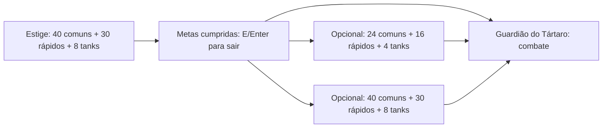

# Base da campanha

O protótipo valida profissões, geração contínua, metas de abates, transições e
combate com o chefe da primeira região. A demo de cinco minutos continua como
modo separado. O refúgio, Caronte, atributos permanentes, baús e perfil salvo já
estão no protótipo. Mini-boss, material persistente e encontro com o ferreiro
estão implementados. Outros encontros e inventário geral continuam pendentes.

## Responsabilidades

| Componente | Responsabilidade |
| --- | --- |
| RunSession | Modo, arena, contagem de abates por tipo, acesso liberado e poderes da tentativa |
| PlayerState | Profissão, arma, atributos, XP, vida, estamina e recargas, sem recursos gráficos |
| Profession / WeaponType / WeaponAttack | Armas iniciais, valores provisórios e geometria dos golpes de espada e socos |
| ProfessionScreen | Pergunta do narrador e escolha única na criação do save |
| SaveSlots / SaveSelectionScreen | Quatro perfis independentes e seleção de personagem |
| EnemyType / EnemyWaves | Atributos e XP por tipo; sorteio de ondas mistas ou de um único tipo |
| EnemyDifficulty | Escala linear de vida/dano pelo tempo total e dificuldade da sala |
| XpAttraction | Movimento e coleta dos cristais, com alcance/velocidade do ímã |
| EnemyNavigation | Campo de caminhos compartilhado, desvios e colisão do corpo |
| RegionDefinition / ArenaDefinition | Salas, metas e destinos imutáveis, carregados de JSON |
| GameScreen / Jogador | Combate, entrada, entidades, mapa e recursos gráficos da arena |
| RouteScreen | Escolha de destino entre arenas |
| BossEncounter / CombatGeometry | Máquina de estados do chefe, padrões, dano e colisão por percurso, sem OpenGL |
| BossRoomScreen | Arena fechada, armas, poderes, avisos, HUD e resultado do combate com o chefe |
| RefugeScreen / CaronteDialogue | Área segura, conversa, altar e preparação da nova tentativa |
| CampaignProfile / PermanentBonuses | Moeda, compras limitadas, profissão e fatos; atributos iniciais da campanha |
| ProfileService / ProfileStore / FileProfileStore | Compra confirmada por gravação, retorno único, arquivo com cópia anterior |
| RunChests | Surgimento alcançável, limite de objetos e benefícios locais da arena |
| RunEncounters | Sorteio único do ferreiro e bloqueio de material por região |
| Luck / BoonRarity / UpgradeChoices | Multiplicador de sorte, categorias e três escolhas ponderadas sem repetição |
| MiniBossEncounter | Perseguição, giro, pedras, vida/dano escalados |
| WeaponRarity / BlacksmithScreen | Arma temporária e encontro seguro com compra por material |

A troca de sala libera recursos gráficos e entidades locais. PlayerState continua
na mesma tentativa, sem guardar texturas ou telas. Reiniciar preserva a profissão,
mas limpa poderes, XP e contagens. Abandonar/fechar descarta o estado temporário;
o retorno guarda Óbolos e eventos no perfil. Fechar no meio da tentativa descarta
o que ainda não foi guardado. Inventário e retomada ainda não existem.

## Profissões iniciais

| Profissão | Vida base | Velocidade base | Arma | Dano base | Intervalo base | Ataque |
| --- | --- | --- | --- | --- | --- | --- |
| Caçador | 100 | 60 | Arco | 5 | 0,65 s | Flecha a 300 unidades/s |
| Ferreiro | 130 | 54 | Espada | 8 | 0,60 s | Cone de 110°, alcance de 36 unidades; pode atingir vários inimigos |
| Vigilante | 85 | 66 | Pistola | 2 | 0,25 s | Projétil menor a 420 unidades/s |
| Apostador | 110 | 62 | Socos | 4 | 0,30 s | Cone de 80°, alcance 24; um alvo por ataque, sorte 4× |

Todos miram com o mouse e atacam segurando o botão esquerdo. Dádivas de dano,
vida e velocidade somam percentuais às bases da profissão; dano é float até a
aplicação no alvo, preservando ganhos pequenos da pistola. Cadência modifica a
taxa base, calculando intervalo = intervaloBase / (1 + bônus). Compras permanentes
usam as mesmas bases. Tabelas: [BALANCEAMENTO_E_SAVES.md](BALANCEAMENTO_E_SAVES.md). Espada e socos verificam estruturas entre jogador
e alvo; projéteis verificam o percurso para evitar atravessar paredes em um quadro.
O narrador pergunta a profissão somente na criação do save; CampaignProfile e
ProfileService impedem alterações posteriores. As escolhas ainda não mudam
diálogos posteriores. Nomes e valores precisam de playtests. O sprite do herói
e o atlas são compartilhados; animações específicas de armas continuam pendentes.

## Geração e experiência

| Inimigo | Vida base | Velocidade | Dano de contato base | XP por derrota |
| --- | --- | --- | --- | --- |
| Comum | 10 | 30 | 8 | 1 |
| Rápido | 6 | 70 | 6 | 2 |
| Tank | 30 | 22 | 16 | 5 |

O rápido tem menos vida, mas persegue mais depressa e exige mais reação.
O tank demanda mais dano e tem contato mais perigoso. A ponderação de XP é inicial.

EnemyDifficulty usa minutos totais da tentativa (t) e difficultySeconds / 60 (s):
vida = vidaBase × (1 + 0,06t + 0,12s); dano = danoBase × (1 + 0,03t + 0,06s).
A curva não é limitada aos cinco minutos da demo e o relógio continua entre salas.
Inimigo recebe um snapshot ao nascer; o chefe, ao entrar em sua sala. Ferir um
inimigo e esperar não recalcula sua vida nem desfaz o dano. XP, velocidade e
comportamento não são multiplicados. A escala da demo usa s = 0.

Ondas têm 35% de chance de usar um único tipo; as demais sorteiam cada membro.
Na campanha, todos os tipos podem aparecer desde o início, com pesos 50%, 35%
e 15% para comum, rápido e tank. A demo preserva a introdução gradual dos tipos.

Não há quantidade total limitada de inimigos ou duração fixa da fase.
Uma proteção de desempenho mantém até 160 inimigos **simultaneamente** ativos;
mortes e remoções permitem novas ondas continuamente. O tamanho/intervalo das
ondas segue uma curva limitada. Essa proteção não define o objetivo nem elimina
a possibilidade de gerar novas ondas durante uma sessão longa.

Inimigos muito distantes são removidos sem XP ou contagem de abate. O jogador
não precisa caçá-los: as metas dependem das derrotas por tipo, e a geração continua.
Não há indicadores de inimigos fora da tela.

## Mini-boss, material e ferreiro

GameScreen tenta criar um MiniBossEncounter após 45 segundos locais, em posição
livre e alcançável, uma vez por sala de combate da campanha. Usa EnemyNavigation;
só persegue durante recuperação. Os ataques são estacionários e sinalizados.
Pedras verificam estruturas antes de atingir o jogador. Morte limpa projéteis,
dá 20 XP e conta um abate geral, sem avançar metas de COMMON/FAST/TANK.
Sair descarta o encontro; não exige derrotá-lo.

RunEncounters sorteia o ferreiro uma vez (3% base) na criação da tentativa e o material
na derrota do mini-boss (1,5% base). Luck aplica a sorte da profissão: 12% e 6% para
o Apostador. O limite é uma unidade por região por save, independente das salas/runs. Main.offerRoute abre
BlacksmithScreen antes da primeira escolha de destino se foi sorteado. Continuar
fecha o encontro e abre RouteScreen; próximas salas não sorteiam outro ferreiro.
Menus e encontro seguro não avançam o tempo de combate.

ProfileService.prepareRun sincroniza o bloqueio do perfil com RunEncounters ao
abrir a arena. collectForgeMaterials confere o ID da região, registra uma unidade
e a região no perfil, e consome a pendência uma vez, protegendo inclusive sessões
não preparadas contra crédito duplicado. enterRoom e newAttempt não removem o
bloqueio. Autosave falho mantém material e registro na memória e sinaliza erro.
Os campos opcionais forgeMaterials e claimedMaterialRegions mantêm compatibilidade
com saves versão 1. Um save antigo com estoque e sem registro reserva o Submundo,
preservando o saldo existente; gastar não remove a região do registro.
A forja confirma a gravação do gasto antes de PlayerState.forgeWeapon.

WeaponRarity modifica a base de dano/taxa da arma, mantendo bônus percentuais.
Projetil registra alvos: flecha rara perfura mais um; pistola rara busca um alvo
vivo com caminho livre em até 100 unidades para um ricochete. Não atinge o mesmo
alvo duas vezes. Espada rara mantém o cone e ganha alcance 48; socos raros ganham
alcance 34, mantendo um alvo por ataque e sem gerar projéteis. Efeitos continuam
entre arenas; outra tentativa usa COMMON.
Valores: [FERREIRO_E_MINI_BOSS.md](FERREIRO_E_MINI_BOSS.md).

## Sorte e categorias das dádivas

Upgrade armazena a raridade do seu efeito, separada de maxRank. UpgradeChoices
agrupa efeitos elegíveis por categoria, respeita limites e exclui cura com vida
cheia. Cada uma das três opções primeiro sorteia a categoria pelo peso e depois
um efeito uniforme dentro dela, removendo o escolhido. Categorias vazias saem
do sorteio; os pesos restantes são normalizados. Se nada for elegível, oferece cura.
BoonRarity usa pesos 70, 23, 6, 1, multiplicados por sorte^ordinal da categoria.
A interface mostra nome/cor da raridade, conservando as três teclas de escolha.
As raridades classificam efeitos; não alteram os percentuais dos efeitos atuais.
Tabelas e limites: [SORTE_E_RARIDADE.md](SORTE_E_RARIDADE.md).

## Acesso ao chefe

Todas as metas precisam ser cumpridas na arena atual. Abates extras de um tipo
não substituem outro. Tempo não abre a passagem; cumprir as metas a libera uma
única vez. Inimigos vivos não impedem sair e novas ondas continuam enquanto o
jogador permanecer. Ao escolher sair, recolher o XP no chão, resolver escolhas
de nível e abrir os destinos disponíveis. Cada combate opcional reinicia somente
suas metas; atributos e poderes continuam. Entrar na sala do chefe não constitui
vitória na campanha: somente derrotar o chefe encerra o trecho jogável.

## Combate com o chefe

BossEncounter alterna introdução, aviso, ataque e recuperação. Marcas travam a
posição avisada; a investida fixa seu trajeto; a rajada usa a direção avisada.
Abaixo de metade da vida, os próximos padrões ganham duas marcas, investida mais
rápida e sete projéteis, com avisos/recuperação menores. O modelo usa passos curtos
e verifica segmentos de movimento para evitar atravessar o jogador sem colisão.

BossRoomScreen preserva PlayerState e dádivas, aplica o dano do modelo através
da resistência/Égide/proteção de ressurreição e impede sair pelos limites da arena.
Projéteis, espada e socos atingem o corpo do chefe; a aura causa dano dentro do alcance.
Pausa congela a sessão, o chefe e as entidades. Ao morrer, a ressurreição disponível
é consumida; sem ela, a tentativa termina em derrota.

Só a morte do chefe chama RunSession.recordBossDefeat, conta um abate e libera o
resultado de vitória. A sala não usa tempo ou Enter como condição de conclusão.
Ataques e perigos param ao derrotá-lo. O reinício cria uma tentativa limpa,
mantendo a profissão. Os valores estão em BossEncounter.java, ainda não no JSON.

Detalhes de padrões e roteiro de playtest: [CHEFE_DO_SUBMUNDO.md](CHEFE_DO_SUBMUNDO.md).

## Refúgio, moeda e perfil

Main oferece quatro saves independentes através de SaveSlots. O Save 1 continua
usando profile.json; os outros usam profile-2.json, profile-3.json e profile-4.json, sem migrar
ou sobrescrever o perfil anterior. P no refúgio abre a seleção de saves.

A campanha chega ao refúgio após escolher a profissão uma única vez, e retorna a ele pelo
resultado de morte/vitória ou por abandono. RefugeScreen contém um jogador novo
de preparação; não guarda a tentativa anterior. Main cria a próxima RunSession
com um snapshot PermanentBonuses. A demo não aplica esse snapshot.

Compras ficam no perfil; dádivas continuam em RunSession e nunca são serializadas.
O retorno concede moeda uma vez por sessão encerrada; reabrir o resultado ou
repetir a chamada não concede novo saldo. Uma morte sem abates/baús não dá moeda.
ProfileService preserva os ganhos na memória se o autosave falha, permitindo
repetir a gravação; a compra só desconta saldo após gravar com sucesso.

O arquivo é UTF-8, versão 1, fora da instalação. A gravação usa um arquivo
temporário, mantém uma cópia anterior válida e troca o principal ao final.
Principal corrompido pode ser lido pela cópia. Um perfil de versão desconhecida
não é sobrescrito. Falha de leitura preserva os arquivos e permite jogar com
estado apenas na sessão; compras ficam indisponíveis. Falhas aparecem na interface.

RefugeScreen expira confirmações após 3,5 segundos de tela; falhas de persistência
são apresentadas separadamente até a resolução. XpAttraction aproxima cristais
pelo alcance e velocidade de PlayerState, sem ultrapassar o centro do jogador;
a coleta concede XP uma vez. Colheita de Deméter aumenta ambos até três níveis
na tentativa. Criar outra RunSession restaura a atração base.

RunChests conta tempo somente durante PLAYING, sorteia posições livres/conectadas
e mantém até três baús por arena. F abre o mais próximo dentro de 24 unidades.
Os baús não bloqueiam movimento ou navegação; saídas e descarte limpam sua lista.
XP pode abrir as escolhas de nível existentes. Cura só é aplicada depois de
resolver morte/ressurreição, impedindo que um baú desfaça uma morte.

Valores, controles e roteiro de teste: [REFUGIO_E_PROGRESSAO.md](REFUGIO_E_PROGRESSAO.md).

## Navegação

Um campo de busca em largura a partir do jogador é compartilhado entre os
inimigos. Posições livres e conectadas são usadas para spawn. O campo é atualizado
quando o jogador muda de célula e periodicamente. O inimigo usa perseguição direta
quando há caminho livre; diante de uma estrutura, segue centros de células
conectadas, inclusive se o desvio inicialmente o afasta do jogador.

Os quatro cantos do corpo são verificados e seus trajetos atravessam as células
do mapa por uma checagem contínua. Isso impede que uma quina seja considerada
livre por amostragem e evita diagonais entre obstáculos. O campo local cobre
65 × 65 células; estruturas dinâmicas e mapas futuros precisarão de validação
própria. Uma área realmente fechada é rejeitada como posição de spawn.

## Editar conteúdo

Arquivo: [submundo-prototype.json](../core/assets/campaign/submundo-prototype.json).

| Campo | Uso |
| --- | --- |
| id / title / start da região | ID estável usado também no limite de material do perfil; nome e sala inicial |
| id / title / description da arena | Identificador estável e textos da interface |
| kind | COMBAT para hordas/metas; BOSS_ROOM para destino de chefe |
| difficultySeconds | Intensidade inicial das ondas e contribuição à escala de vida/dano; não é prazo |
| killGoals | Mapa de COMMON, FAST, TANK para quantidades inteiras positivas |
| exits | Até três IDs de destino; vazio na sala do chefe |

COMBAT exige pelo menos uma meta e uma saída; BOSS_ROOM exige metas/saídas vazias.
IDs únicos, destinos válidos, alcance de todas as salas e ausência de ciclos
são verificados. durationSeconds foi removido; não há condição de limpar a horda.

## Validação

`build` testa metas independentes, XP/tipos, geração prolongada, armas, preservação
de profissão e estado e navegação em pilares, quinas, estruturas em U, corredores
estreitos, coordenadas negativas, alvos móveis e áreas fechadas. Também verifica
avisos sem dano, esquiva, trajetória da investida, segunda fase, duração dos
projéteis, fim dos perigos após a morte do chefe e contagem única da vitória.

`:lwjgl3:smokeTest` usa OpenGL real para verificar seleção de profissão, arco,
espada, pistola, socos, XP por tipo, abate contado uma vez, tempo sem desbloqueio,
continuidade de ondas após as metas, saída com inimigos vivos, recompensa de saída,
caminhos, sala do chefe, pausa dos ataques, quatro armas contra o chefe, aura,
segunda fase, vitória por um ataque real, morte, ressurreição, refúgio, compra,
diálogo e expiração das confirmações, reinício sem dádivas, saves independentes,
profissão fixa, coleta com ímã, bônus percentuais, escala dos inimigos, mini-boss,
limite regional salvo, ferreiro, forja, poderes das armas raras, sorte e raridades
ponderadas e baús interativos. Metas e vida do
chefe são aceleradas em parte do teste; ele não comprova balanceamento. Jogar sessões completas e validar o desempenho das
hordas permanece necessário antes da divulgação.
