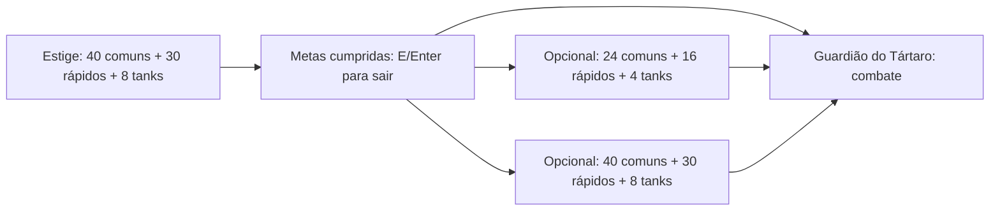

# Base da campanha

O protótipo valida profissões, geração contínua, metas de abates, transições e
combate com o chefe da primeira região. A demo de cinco minutos continua como
modo separado. O refúgio, Caronte, atributos permanentes, baús e perfil salvo já
estão no protótipo. Mini-boss, material persistente e encontro com o ferreiro
estão implementados. O M5 acrescenta a Camponesa das Cinzas e o Fazendeiro Épico.
Inventário geral e próximas regiões continuam pendentes.

## Marco 1 implementado

CombatHud atende hordas/chefe com barras compactas, metas, fase e disponibilidade
do dash. BoonPanel concentra números detalhados; XP não é arredondada pelo HUD.
GameScreen cria um marcador de saída em posição navegável após as metas, mantendo
o atalho E/Enter sem exigir proximidade. Sinais de recompensa e Fúria são contextuais.

VisibleArea usa câmera/zoom/viewport e a máscara do quadro para o corpo visível.
GameAudio.play(cue, emitter) associa uma voz ao Carrasco; stopEmitter limita o
descarte ao emissor, preservando as demais vozes. Checagem também acontece no draw.

BossEncounter tem ciclo inicial fixo, blocos embaralhados sem repetições consecutivas,
vida 500, recuperação .95/.65 e rajada 5/9. Shot captura dano no lançamento.
RunStatistics observa um modelo de chefe sem recursos GL e copia BossFightSummary
ao encerrar a sala/run, liberando a referência. Room recebe bossFight opcional;
JSON versão 1 sem esse campo permanece válido. O relatório acrescenta páginas
de métricas somente nas salas que têm esse resumo. Snapshots permanecem imutáveis.
Detalhes: [MARCO_1_LEITURA_E_CHEFE.md](MARCO_1_LEITURA_E_CHEFE.md).

## Marco 2 implementado

GameDifficulty guarda os três modos e percentuais inteiros de recompensa.
CampaignProfile tem dificuldade fixa; ProfileService.createCharacter grava uma
cópia com profissão/dificuldade antes de substituir o perfil. DifficultyScreen
mantém escolhas locais até a confirmação; cancelamento/falha não criam personagem.
Main copia o modo para RunSession, que o preserva em newAttempt.

EnemyDifficulty aceita multiplicadores positivos abaixo de 1 para Fácil.
RunSession compõe modo × escala de tempo/sala × Fúria. Almas acumulam centésimos
inteiros; Óbolos usam a soma de bases antes da conversão para inteiros.
A fração final não segue para outra tentativa. Previews de baús mostram o ganho
efetivo. RunReport registra difficulty; perfil/relatório sem campo assumem Média.
IDs, versões JSON e dados anteriores são preservados.
Detalhes: [MARCO_2_DIFICULDADES_E_ECONOMIA.md](MARCO_2_DIFICULDADES_E_ECONOMIA.md).

## Marco 3 — piloto visual implementado

PilotArt carrega um TextureAtlas nomeado sob demanda, compartilhado por Main e
descartado somente no encerramento. Fontes PNG/FNT vêm de UiTheme e pertencem
às telas. FontBaker/PilotAtlasBaker são ferramentas offline; não são runtime.
ActorAnimation conserva direção ao parar e fase ao virar, com histerese diagonal.
A expansão de 15/10/2026 acrescenta uma mistura de 0,10 s entre direções.
ExpandedArt, pertencente a PilotArt, carrega o segundo atlas uma única vez:
oito profissões (seis quadros/direção) e seis papéis de inimigo (quatro).
Cada corpo tem máscaras posicionáveis próprias e usa a direção predominante
durante a mistura; acessórios e efeitos não aumentam sua silhueta de contato.
Flecha/impacto/XP/dash e os novos golpes/poderes têm sprites, sem alterar regras.
EnemySpawner passa a referência emprestada do atlas para novos inimigos.

CaronteDialogue lê JSON por classpath; DialoguePlayback cuida da revelação,
um comando por fala, sem moeda/eventos. RefugeScreen registra a conclusão
pelo serviço de perfil existente. T alterna texto instantâneo durante esta sessão.
Base: [MARCO_3_BASE_VISUAL.md](MARCO_3_BASE_VISUAL.md).
Elenco atual: [EXPANSAO_VISUAL.md](EXPANSAO_VISUAL.md).

EquippedArt substitui a arma em camada por corpos equipados: 926 poses de origem em
64×64, disponíveis em 1.280 combinações de direção/ação. Profissões e conjuração
do chefe usam cinco direções de origem, com espelhamento horizontal das três da direita. A máscara usa alfa no recorte central de
tronco/pernas; a extensão visual da arma fica fora do contato. Jogador conserva
orientação de mira entre tiros e usa a passada real para locomover.
EncounterAnimation consulta progresso de BossEncounter/MiniBossEncounter, sem
resolver dano; TacticalVisuals desenha avisos em texturas, sem ShapeRenderer.
WeaponVisuals limita-se à rotação de efeitos/projéteis; os ícones de arma são
mostrados somente por BlacksmithScreen. DivineVisuals desenha poderes/impactos. FeedbackVisuals reutiliza os sprites para respostas a acertos.
ChestVisuals mantém apenas a cauda cosmética da abertura, limitada a seis imagens;
RunChests entrega/remove cada recompensa uma vez. BoonChoiceView concentra a
tela inteira e os retângulos dos cartões, incluindo catálogos reduzidos.
BoonPanel reutiliza os mesmos ícones. RefugeScreen usa o retrato ilustrado do
protagonista, mantendo o avanço/conclusão do diálogo no serviço existente.

## Marco 5 implementado

Implementado em **23/10/2026**, com **290 testes unitários, integração OpenGL e
pacote Windows aprovados**. Balanceamento em partidas ainda pendente.
[Regras e capturas](MARCO_5_FAZENDEIRO.md).

CampaignProfile registra FarmerQuest como NOT_STARTED, ACCEPTED, SEED_FOUND ou
COMPLETED; o campo ausente em perfis v1 assume NOT_STARTED. RunSession recebe o
estado no prepareRun e conserva avanços entre salas. ProfileService aceita a
missão após gravar; collectFarmerQuest preserva objetivos ganhos em memória para
retry e impede transferir a missão entre personagens. recordMiniBossDefeat gera
semente garantida somente após aceitação, sem depender do Fragmento de Forja.
recordBossDefeat no Submundo conclui a missão quando a semente está disponível.
Morte, abandono e recarga conservam aceitação/semente no perfil.

RunEncounters faz uma rolagem independente de 10% base para a Camponesa, após
liberar a passagem do Estige. Luck.chance multiplica a base pela sorte, até 100%:
o Apostador 4× tem 40%. O RNG não consome a sequência de ferreiro/fragmento.
Main.offerRoute encadeia recompensa, ferreiro, FarmerQuestScreen e destino;
fechar/reabrir ou mudar de sala não sorteia novamente. O encontro opcional não
avança combate, Fúria ou recargas.
FarmerQuestScreen também funciona como diário pelo atalho J no refúgio;
BoonPanel mostra a descrição do objetivo aceito em Tab, sem acrescentar HUD fixo.

SharedProgress guarda farmerUnlocked opcional, falso em arquivos v1 antigos.
A conclusão libera novos personagens sem mudar classes ou moedas. Main.shared
recupera o acesso a partir de perfil COMPLETED; uma falha global deixa a recompensa
disponível para retry. A exclusão aguarda preservar o desbloqueio pendente.
ProfileService também valida o acesso na criação, além da interface.

PlayerState conserva a ferramenta ativa entre salas; switchTool alterna ancinho
e foice mantendo o cooldown de ataque. Q só é tratado no combate ativo. Os bônus
percentuais usam dano/cadência da ferramenta atual e uma forja beneficia ambas.
Cada nova tentativa começa com ancinho. MenuPages usa a contagem do catálogo:
nove profissões em três páginas, oito saves em duas, sem cartões fora do catálogo.

## Marco 6 — lote de diálogos e NPCs

Implementado em **23/10/2026**, com **302 testes unitários, OpenGL e execução
nativa do pacote Windows aprovados**. O lote seguinte de
[dano/morte](MARCO_6_DANO_E_MORTE.md) passou em 320 testes, OpenGL e execução
nativa do pacote Windows. O lote de cenários e rotas de 25/10/2026 está descrito
abaixo; o M6 geral continua em andamento.
[Detalhes e procedência](MARCO_6_DIALOGOS_E_NPCS.md).

DialogueLine contém falante, texto e DialoguePortrait. O enum identifica quatro
expressões de cada NPC, além do protagonista. DialoguePlayback aceita listas
imutáveis ou a Conversation compatível de Caronte, revela 42 code points/s e
retorna REVEALED/ADVANCED/FINISHED. Alternar T não rebobina o texto já visível;
um comando de leitura revela ou avança, sem realizar compras ou conceder eventos.
DialoguePanel desenha as três telas com a geometria de cada uma, reutilizando
fontes/molduras e regiões emprestadas de ExpandedArt; as telas não possuem as texturas.

CaronteDialogue conserva os eventos prioritários e seleciona comentários opcionais
de missão/forja com event null. A substituição de {returns} preserva o retrato.
JSON sem retrato usa o padrão por falante; scripts opcionais ausentes usam repeat
na seleção. O catálogo antigo com apenas quatro chaves continua funcional.
BlacksmithDialogue seleciona falas pela profissão, arma ativa, material e raridade,
com rara prevalecendo sobre estoque. Respostas de sucesso/falha vêm após a ação
explícita de forja, que continua usando o commit existente do ProfileService.

No Ferreiro, Espaço ou clique no painel lê, T alterna o modo, 1/E/botão compra
e 2/Enter/Esc sai. A proteção de entrada de 0,2 s permanece; compras por clique
exigem soltar o mouse. CamponesaDialogue mantém uma linha por estado, as strings
antigas e o retrato por etapa. A aceitação conserva a proteção de 1,5 s e o commit;
o diário J começa revelado. Nenhum desses modelos chama serviços ou avança a run.

## Marco 6 — cenários e rotas

Implementado em **25/10/2026**, com **336 testes de lógica e zero falhas,
integração OpenGL e execução nativa do pacote Windows aprovados**. Os resultados
históricos de 302/320 testes correspondem aos lotes anteriores. O M6 continua
em revisão humana; o primeiro incremento de tutorial/desfecho do M7 foi implementado e verificado em 27/10.
[Entrega, origem e critérios](MARCO_6_CENARIOS_E_ROTAS.md).

SceneryTheme define REFUGE, STYX, ASHES, SHADOWS e GUARDIAN, com chaves estáveis,
títulos e seleção pela arena. Demo e combate desconhecido usam Estige; Kind.BOSS_ROOM
seleciona Guardião. Não há mudança de IDs, esquema de save ou conteúdo de região.
Cada tema oferece seis pisos e três obstáculos; floorVariant usa três bases com
96% de probabilidade e três detalhes com 4%. obstacleVariant e os demais sorteios
visuais usam hashes independentes do RNG de combate/encontros.

TileLayout.solid preserva exatamente `new Random(seed ^ (x*73856093L) ^ (y*19349663L))`,
`nextInt(3)` e `nextFloat() < .012f`, incluindo a rejeição rara de nextInt.
Seu LCG de 48 bits não aloca Random por consulta. TileMap conserva área segura e
bounds; ehSolido não consulta nem cria Tile. O cache visual usa coordenadas long,
janela visível com duas células de margem, zoom ortográfico e teto de 8.192 tiles.
Evicção/revisita não altera aparência ou colisão; o construtor legado permanece.

SceneryArt pertence a PilotArt e carrega um atlas de 52 regiões em uma página
1024×1024, 4 MiB RGBA: 45 tiles de 64×64, três previews de 320×180 e quatro
quadros de passagem de 96×96. Telas e mapas emprestam regiões e não descartam
essas texturas. SceneryVisuals desenha bordas fora dos bounds físicos originais
do refúgio/chefe e cria recortes centrais de preview sem distorcer sua proporção.

RouteScreen mantém título, descrição, evento fixo da tentativa, recompensa e
metas, com hover, espera de 0,2 s e soltura do mouse antes de outro clique.
Um destino único fica centralizado. Consultar a tela não avança a sessão nem
repete recompensas/eventos. A passagem luminosa substitui apenas o beacon visual:
continua em ponto alcançável próximo ao jogador e E/Enter continua global após
as metas, sem colisão ou exigência de proximidade. Economia e RNG de gameplay
permanecem os mesmos. O tutorial e o fechamento da primeira travessia pertencem
ao incremento seguinte do M7; a revisão humana do M6 continua.

## Marco 7 — tutorial e Centelha da Insurgência

Primeiro incremento implementado e verificado em **27/10/2026**.
**372 testes de lógica passaram sem falhas**, com 36 novos: 18 de persistência,
11 do guia e sete da história. **OpenGL e execução nativa do pacote Windows aprovados**.
O nativo usa Java incluído, PATH sem Java externo, perfis em memória, outra pasta
de trabalho e 24 efeitos/música via OpenAL nativo silenciado. Playtests humanos
continuam pendentes. Os 336 testes acima
correspondem ao lote anterior. [Regras e critérios](MARCO_7_TUTORIAL_E_CENTELHA.md).

TutorialGuide mantém os dez TutorialTopic por personagem, selecionando uma dica
por contexto e sete segundos de leitura ativa. Ações reais concluem tópicos antes
do prazo: deslocamento, ataque emitido, dash aceito, XP recebida, escolha de
dádiva, metas, saída usada, chefe derrotado, compra confirmada e conversa/partida
do refúgio. TutorialPanel compartilha F1, duas páginas de campanha (uma na demo),
H, rodapé e sincronização com o perfil. O guia consome o quadro de abertura e
fechamento; simulação e leitura contextual ficam congeladas. Pausa, Tab e áudio
mantêm suas proteções. Avisos do chefe, Fúria, saída e baús têm prioridade.
As lições da demo ficam locais; H continua sendo preferência do personagem.

O autor aprovou a Centelha como poder que permitirá ferir deuses. O incremento
atual só registra uma conquista narrativa, sem alterar PlayerState, dano,
economia, sorte ou raridades. ProfileService.settle concede
`INSURGENCE_SPARK_OBTAINED` somente à vitória real do Submundo na campanha,
com chefe derrotado e identidade do personagem correspondente.

Main.finishRun liquida perfil, compartilhado e relatório antes de apresentar a
queda. UnderworldEndingScreen aparece depois da queda do Guardião e antes de
GameOverScreen se a leitura ainda não foi concluída. UnderworldStory carrega
`dialogues/underworld-ending.json`: `title()`, `subtitle()`, `nextObjective()`,
`continuationNotice()` e `lines()` imutável. O parser estrito valida campos,
tipos, duplicações, cinco a sete falas, limites e retratos compatíveis; o JSON
entregue tem sete falas com os retratos existentes.

A tela usa DialoguePanel/DialoguePlayback, ChoiceInputGuard de 1,5 s e soltura
do ataque. Enter/E/Espaço/clique na fala revela ou avança, T alterna o modo e
Esc adia sem registrar `UNDERWORLD_EPILOGUE_READ`. Confirmar a última fala chama
ProfileService.finishUnderworldEpilogue. V no refúgio e C no resultado permitem
retomar/rever a conversa; consultar não liquida a tentativa novamente. Depois
de concluído, o desfecho não reaparece automaticamente. A narrativa distingue
a maldição de retorno da Centelha e o retorno voluntário para preparar a ascensão;
o rodapé informa que a continuação está em desenvolvimento.

No lote do tutorial, CampaignProfile ainda usava `version: 1` e acrescentou
`narrativeVersion: 1`, `tutorialSeen` e `tutorialEnabled`. O lote de checkpoints
passa a escrever `version: 2`, conservando essa versão narrativa. Os campos do
tutorial são opcionais nos arquivos
antigos; ausência dos dois últimos significa conjunto vazio e dicas ativadas.
Uma versão narrativa desconhecida usa a proteção UnsupportedVersion. Perfis
sem versão narrativa e com vitórias anteriores migram a Centelha, sem marcar
a leitura. Um perfil já versionado não infere a conquista pelo contador.

ProfileService.completeTutorial(characterId, topic), setTutorialEnabled(characterId,
enabled) e finishUnderworldEpilogue(characterId) verificam a identidade do save.
Falhas de autosave conservam fatos/preferência em memória para retrySave por S
no refúgio. Os dados são pessoais e reiniciam ao excluir o slot, independentes
de SharedProgress. A aquisição não acrescenta atributo nem muda o reset das dádivas.
Retomada por checkpoints é descrita no incremento de 29/10/2026 abaixo;
próximas regiões continuam em aberto. Vídeo,
controles e tamanho do HUD têm seus próprios incrementos abaixo.

## Marco 7 — vídeo e janela

Incremento de **27/10/2026**, implementado e verificado.
Este bloco descreve a entrega original de dois modos. A adaptação atual e o
formato v2 estão no [incremento de três modos](MARCO_7_MODOS_DE_EXIBICAO.md)
e na seção seguinte, com lógica, OpenGL e execução nativa aprovados.
**389 testes de lógica aprovados, sem falhas ou erros**: base 372 + 12 em
VideoSettingsTest + cinco em GdxVideoBackendTest, com Graphics simulado.
**OpenGL e execução nativa do pacote Windows aprovados**; os 372 testes e aprovações do
incremento anterior são históricos. [Regras e limites](MARCO_7_VIDEO_E_JANELA.md).

VideoSettings valida tamanho de janela, fullscreen e VSync. VideoSettingsService
aplica uma prévia de 15 s por System.nanoTime e só grava confirmação explícita.
O snapshot de reversão usa a janela real, inclusive tamanho manual. Tick é
chamado por Main.render independentemente do combate. A guarda busy impede
aplicar/confirmar durante callbacks nativos; um cancelamento reentrante fica
pendente até a operação terminar. Falha na reversão tenta uma janela segura.

GdxVideoBackend usa a resolução atual de getDisplayMode() para tela cheia e
preserva dimensões de janela. Oferece cinco presets de 800×450 a 1920×1080;
recusa janelas que excedem o espaço disponível. VSync desligado usa 120 FPS;
ligado usa limite de primeiro plano refreshRate + 1, com fallback de 60 Hz
somente quando o monitor informa zero; taxas positivas de 24/30/50 Hz são respeitadas.
Tamanho do HUD e remapeamento de entrada pertencem a incrementos separados.

F2 abre VideoSettingsScreen pelo menu e VideoPanel sobreposto no refúgio,
GameScreen e BossRoomScreen. A sobreposição pausa a simulação e consome o quadro
de abrir/fechar, preservando os estados anteriores de pausa/Tab/áudio/dádiva.
Editar altera somente um draft; Enter/Aplicar começa a prévia e Enter/Manter
confirma. Esc/timeout reverte. Fechar painel, trocar de tela, pausar a aplicação
ou encerrar Main cancela uma prévia pendente. Há proteção de entrada de 0,2 s
e soltura do mouse.

FileVideoSettingsStore guarda video-settings.json global, version1, em UTF-8,
com temporário, troca atômica quando possível e backup válido .bak. Versão
futura é preservada; falha de leitura usa preferências apenas na sessão sem
sobrescrever o arquivo. Falha de confirmação mantém imagem/preferência pendente
em memória; S no painel chama retrySave. Dados não pertencem a CampaignProfile
ou SharedProgress e sobrevivem à exclusão de personagens.

Smokes usam VideoSettingsStore.memory e VideoBackend.memory ou backend falso,
sem alterar a configuração física do monitor. Verificar UI/estado por OpenGL
não equivale a homologar tela cheia, VSync ou resoluções físicas reais.
O pacote nativo foi aprovado com Java incluído, PATH sem Java externo, 24 efeitos
e música em OpenAL nativo silenciado e perfis em memória. Seu diagnóstico também
renderiza VideoSettingsScreen com backend em memória. Resoluções físicas, vários
monitores e HiDPI reais continuam pendentes de revisão manual.
Cutscenes em camadas têm [direção aprovada](CUTSCENES_E_ABERTURA.md), e o piloto
da abertura foi implementado no incremento abaixo. O acabamento é iterável.

## Marco 7 — três modos de exibição e monitor atual

Incremento de **28/10/2026**, aprovado em **457 testes de lógica sem falhas ou
erros, integração OpenGL e execução nativa Windows**. VideoSettings usa Mode.WINDOWED,
BORDERLESS e FULLSCREEN; width/height continuam sendo o tamanho preferido da
janela. O JSON v2 grava mode em texto; a leitura migra v1/fullscreen booleano.
Parser estrito e FileVideoSettingsStore preservam versões futuras no principal
e no backup, inclusive contra gravação direta. Os 439 testes anteriores são
históricos do HUD; 18 testes de lógica foram acrescentados neste lote.

VideoBackend oferece adapt e Snapshot/settings, snapshot/restore. O serviço
adapta antes de aplicar/comparar/confirmar, conserva a prévia monotônica de
15 s e usa o snapshot nativo para restaurar posição, tamanho, monitor e flags.
Fallback tenta janela segura se a restauração não for possível; falha do
próprio provedor de área segura é tratada sem gravar o alvo não confirmado.
VideoBackend.matches valida o estado real na inicialização e confirmação,
recusando uma janela sem bordas que tenha sido reposicionada fora da cobertura
esperada com Win+setas durante a prévia.

GdxVideoBackend recebe WindowPlacement. Main(VideoBackend) permite ao launcher
fornecer Lwjgl3WindowPlacement com consultas GLFW de monitor, área útil,
coordenadas lógicas, moldura, decoração e redimensionamento. A ponte genérica
Graphics é um fallback aproximado; a produção desktop injeta a ponte nativa.
Janela decorada/redimensionável cabe na área útil; borderless usa janela sem
decoração sobre os bounds totais; fullscreen usa o modo exclusivo atual do
monitor. Presets ficam ativos apenas em WINDOWED. Origens negativas e tamanho
lógico de janela são preservados; framebuffer HiDPI não dimensiona a janela.

Os smokes gráficos usam backend falso e stores em memória. O diagnóstico do
launcher consulta geometria nativa no primeiro quadro, com
PACKAGED_MONITOR_SMOKE_OK, e desenha o painel de três modos em janela oculta.
O diagnóstico opcional --display-smoke-test aplica os três modos nativos reais
nessa janela, na resolução/taxa atuais do monitor, e restaura o snapshot em
finally. O script do pacote exige PACKAGED_DISPLAY_MODES_SMOKE_OK; sua execução
foi aprovada com WINDOWS_PACKAGE_OK e código zero, com Java incluído, PATH sem
Java externo, perfis/preferências em memória e OpenAL null. O diagnóstico
confirmou os três modos reais e a restauração de posição/flags, no monitor
atual e sem escolher outra resolução/taxa. O launcher protege render contra
reentrada nos callbacks de redimensionamento. Os smokes de UI continuam com
backend falso.
Resultados e capturas em [MARCO_7_MODOS_DE_EXIBICAO.md](MARCO_7_MODOS_DE_EXIBICAO.md).
Uma janela oculta no monitor atual não homologa uso visível de tela cheia,
Alt+Tab visível, vários monitores físicos, remoção real ou HiDPI real. Esses cenários continuam
em revisão manual. HUD, controles, abertura, colisões e progressão não mudam.

## Marco 7 — piloto da abertura em camadas

Incremento autorizado em **27/10/2026**, com visuais de Zeus clássico e esposa
grega adulta escolhidos pelo autor. Modelo, persistência, renderer e atlas estão
implementados. **412 testes de lógica passaram, sem falhas ou erros**, com 23
novos (sete de story, sete de playback e nove de persistência). **OpenGL e execução
nativa do pacote Windows aprovados em 27/10/2026**. Base histórica: 389 do vídeo.
[Contrato e regras do piloto](PILOTO_DA_ABERTURA.md).

O diagnóstico nativo desenha o atlas, a linha do tempo e as legendas da abertura
no executável empacotado, com Java incluído, PATH sem Java externo e perfis em
memória. O áudio usa OpenAL com dispositivo null. O resultado foi
`WINDOWS_PACKAGE_OK`; avaliação humana do piloto e demais entregas do M7
continuam abertas.

OpeningStory carrega cutscenes/opening.json: ID opening-v1, seis ShotId e
durações 6/7/7/9/7/9 s. Layers descrevem asset, posições/alfas inicial e final,
tamanho e respiração; shots têm zoom inicial/final, legendas e cues de SoundCue.
Parser valida estrutura, tipos, duplicações, limites, ordem e checkpoints.
OpeningPlayback é puro, com tempo/progresso de UI, pausa, avanço mínimo de 1,5 s,
pulo e cues liberados uma vez. Não guarda perfil, textura ou estado de combate.

Main.openOpening(Supplier, recordCompletion) e enterCampaign integram o fluxo:
profissão/dificuldade são confirmadas antes de uma abertura pendente; o destino
é criado sob demanda. I/ABERTURA no menu funciona sem criar personagem, e I
no refúgio revê com recordCompletion=false. A demo não dispara automaticamente.
OpeningScreen desenha layers ordenados por SpriteBatch, interpola zoom/posição/
alfa e mantém a base dos pés na respiração. Sete poses de personagem usam
regiões de 432×480 no atlas cinematográfico. Legendas têm área própria 960×540
com letterbox. Sons saem no update, nunca em draw. O atlas cinematográfico é
próprio da tela, com filtro Linear e dispose ao sair.

Espaço pausa, Enter/Próximo avança após 1,5 s, Esc/Pular pede confirmação de
0,2 s/soltura e F2 sobrepõe vídeo sem avançar o filme. Pausa da aplicação
congela a cena; dispose não registra conclusão nem cria o destino. A tela
limita delta a 0,1 s para não consumir trechos durante arrasto/parada longa.

CampaignProfile acrescenta cinematics opcional como array de {id,state}.
CinematicState tem UNSEEN, COMPLETED, SKIPPED e LEGACY; openingPending consulta
UNSEEN. Ausência do array com attempts>0 migra LEGACY, sem alegar exibição.
JSONs novos sempre escrevem o array para impedir inferência por tentativas
em arquivos modernos. ProfileService.markOpening(characterId, skipped) verifica
profissão/identidade e só registra UNSEEN; demais estados são idempotentes.
Falha de IO mantém o registro em memória para S no refúgio. Concluir/pular/
rever não liquida tentativa, dá moedas, concede Centelha ou marca leitura do
desfecho. Excluir personagem limpa seu registro, preservando SharedProgress.

## Marco 7 — controles remapeáveis

Incremento implementado e aprovado em **424 testes de lógica, sem falhas ou
erros, integração OpenGL e execução nativa do pacote Windows**.
Os 412 testes e as aprovações do lote acima são históricos da abertura.
[Contrato, controles e verificações](MARCO_7_CONTROLES.md).

ControlAction contém 11 ações de gameplay. InputBinding identifica KEY/MOUSE e
código, rótulo e estado físico. ControlSettings mantém uma ou duas associações
por ação, imutáveis, sem comandos duplicados entre ações; todas permanecem com
ao menos uma entrada. Teclas de menus/atalhos são reservadas, Enter pertence
somente a INTERACT e os botões de mouse aceitos vão de 0 a 4. A mira continua
com o mouse; menus e confirmações preservam navegação própria.

Main.controlSettings fornece ControlSettingsService e Main.controls fornece
GameControls. Os construtores de testes usam store em memória. A versão de
produção usa FileControlSettingsStore e control-settings.json fora da instalação,
separado de CampaignProfile, SharedProgress, áudio e vídeo. O JSON versão 1
valida tipos, campos duplicados/desconhecidos, ações completas, códigos e
conflitos. Versões futuras são identificadas antes do schema: um principal
futuro não usa fallback; um backup futuro impede sobrescrita mesmo com principal
válido. Gravação usa temporário, movimento atômico quando possível e
backup validado. Falha de IO mantém preferências na sessão e permite retry S
no painel; falha de leitura aplica padrão na sessão, sem sobrescrever o original.

ControlsSettingsScreen abre pelo menu, por F3 ou botão CONTROLES. ControlsPanel
é sobreposto no refúgio, GameScreen e BossRoomScreen sem trocar a tela. Dois
grupos de até seis ações permitem editar principal/alternativo; o rascunho só
vale após Enter/Salvar. Restaurar padrão altera o rascunho. Captura aguarda
0,2 s e soltura dos comandos; Esc cancela e Delete/Backspace remove sem zerar
uma ação. Conflitos são exibidos e conservam a associação anterior.

Abrir/fechar consome o quadro e pausa a simulação antes do update, conservando
estados de consulta de dádivas, pausa, escolha, diálogo, altar e chefe. Aplicar
ou fechar chama blockUntilReleased. GameControls.poll libera entradas soltas;
pressed/justPressed respeitam o bloqueio. physicallyPressed permite que os
guardas de escolha continuem exigindo soltura do ataque físico mesmo enquanto
o comando está bloqueado. Rótulos de ajuda consultam as associações atuais.

ControlSettingsTest acrescenta 12 testes de lógica, totalizando 424 aprovados.
ControlSmoke passou na integração OpenGL, com M7_CONTROLS_OK e DEMO_SMOKE_OK,
exercitando os fluxos reais, execução de controles personalizados, captura,
persistência e overlays pausados. As capturas nas duas resoluções estão no
documento do incremento. PackageWinX64 e a verificação do executável encerraram
com código zero e WINDOWS_PACKAGE_OK, com Java incluído, PATH sem Java externo,
stores em memória e OpenAL null com 24 efeitos e streaming. O launcher renderiza
ControlsSettingsScreen no quadro 29, após a abertura, e emite
PACKAGED_CONTROLS_SMOKE_OK. A revisão humana dos controles continua.
Remapeamento não encerra M7, revisão visual do M6, playtests ou o incremento
separado de retomada de tentativa. O ajuste de HUD pertence ao incremento abaixo.

## Marco 7 — tamanho do HUD de combate

Implementado em **28/10/2026**, com **439 testes de lógica sem falhas ou erros,
integração OpenGL e execução nativa do pacote Windows aprovadas**. A base
histórica anterior é de 424 testes do remapeamento; este lote acrescenta 12
de preferências e três de layout. [Contrato e validação](MARCO_7_ESCALA_HUD.md).

HudSettings guarda percent inteiro em 80–125, padrão 100. HudSettingsService
aplica a confirmação e mantém uma gravação falha pendente. A produção usa
FileHudSettingsStore com hud-settings.json separado de vídeo, controles e
personagens, UTF-8, temporário, troca atômica e backup validado. JSON versão 1
valida campos/tipos/limites; uma versão futura é reconhecida antes do schema.
Principal futuro impede fallback; backup futuro também é protegido na escrita.
Falha de leitura permite somente preferência na sessão, conservando o arquivo.

VideoPanel abre HudPanel em uma página própria por F2 → TAMANHO DO HUD. A
prévia local mostra jogador/relógio; rascunho não afeta a arena. Barra ajusta
1 ponto percentual; setas/−/+ ajustam 5; presets são 80/100/125. Enter salva,
restaurar altera o rascunho, S repete gravação, Esc volta à página de imagem
e F2 fecha. A página usa a pausa existente de vídeo, consome entrada/saída e
bloqueia comandos segurados ao aplicar/fechar.

F3/pausa da aplicação cancelam o arrasto e reiniciam a proteção de input,
exigindo soltura do mouse e 0,2 s antes de editar novamente. HudSmoke cobre a
regressão em arena, refúgio e chefe, além da pausa da tela de vídeo independente.
Após essa proteção, a suíte completa passou com M7_HUD_OK e DEMO_SMOKE_OK.

HudLayout define âncoras esquerda (14,526) e direita (946,526) na área 960×540.
HudScaleRenderer reutiliza/restaura matrizes de transformação entre grupos,
sem alterar projeções, viewports, câmera do mundo ou coordenadas de input.
Player, metas/relógio e barra/aviso do Guardião escalam juntos com seus ícones,
fontes e barras. O aviso ocupa outra caixa de 422×42 na coluna direita, abaixo
da barra do chefe, com até duas linhas. Em 125%, a separação horizontal de
jogador/chefe é de 92 unidades lógicas.

Menus, diálogos, cutscenes, rodapés contextuais, números de dano, barra sobre
o Carrasco, telegráficos e borda de dano conservam a apresentação atual.
O tamanho do HUD não inicia a prévia nativa de 15 s, muda regras/economia ou
implementa retomada de tentativa, que tem seu incremento separado abaixo.
A abertura atual permanece preservada.
O diagnóstico do launcher usa o construtor de VideoSettingsScreen que abre
diretamente HudPanel, desenha os indicadores de amostra e emite
PACKAGED_HUD_SMOKE_OK no quadro 29. PackageWinX64 e verify_windows_package.ps1
encerraram com código zero, WINDOWS_PACKAGE_OK, Java incluído, PATH sem Java
externo, perfis/preferências em memória e OpenAL null com 24 efeitos e música
em streaming. Construtores legados de Main usam HudSettingsStore em memória.
Revisão humana e as demais entregas do M7 continuam pendentes.

## Cutscenes futuras — direção registrada, sem implementação

Em **27/10/2026**, o autor definiu Symphony of the Night e Metal Slug como
referências para cenas/diálogos com atuação em sprites na sala. A abertura
existente fica preservada. O [contrato futuro](CUTSCENES_E_ABERTURA.md) registra
gatilhos por cruzamento em coordenadas do mundo, modo CUTSCENE, diretor de
ações por eventos, sincronismo de voz/animação/objetos, estado final idempotente
e planos ou geometria 3D texturizados para efeitos de perspectiva.

OpeningStory/OpeningPlayback continuam específicos do piloto. Planejar modelos
separados para sequências gerais e um canal de voz com término identificável,
alternativa sem áudio e limite para esperas. O GameAudio.play atual informa
reprodução aceita, não conclusão de diálogo. DialoguePlayback cuida da leitura;
texto revelado, fim de áudio e confirmação do jogador são eventos distintos.

Main.setScreen descarta a tela anterior: uma cena dentro da arena precisará de
modo/overlay na própria sala ou posse explícita do mundo. Suspender combate,
spawn, coleta, tempo da run e Fúria enquanto atores/câmera da cena atualizam.
Retornar ao mesmo GameScreen descartado não é uma estratégia válida. Novos
IDs/políticas de registro devem conservar a compatibilidade de opening-v1.
Nenhuma API nova, troca de renderer ou migração de save foi feita nesta anotação.

## Arquitetura planejada após os playtests

O [roteiro de 13/10/2026](ROTEIRO_DE_MELHORIAS.md) prioriza HUD/áudio/Guardião,
dificuldades, base visual, catálogo/altar, Fazendeiro e acabamento da região.
As responsabilidades abaixo descrevem o sistema atual; a ampliação deverá:

- Expandir o piloto visual mantendo dano, navegação e persistência fora
  da apresentação e preservando a correspondência das máscaras.
- Ampliar a definição de dádivas para conteúdo por dados: o M4 já oferece região
  de obtenção, raridade, recarga, limites e seis compras do altar. Novas regiões
  deverão reutilizar o filtro e conservar os poderes adquiridos na tentativa.
- Externalizar mais falas/opções/condições, reutilizando o estado de missão e
  desbloqueio compartilhado do M5. Verificar migração e recuperação antes de
  ampliar o catálogo de desafios.
- Comparar as duas ferramentas do Fazendeiro nas três dificuldades, preservando
  recarga compartilhada, atributos ativos e forja única ao ajustar os valores.

HUD, visibilidade sonora e métricas entraram no M1; dificuldade/economia no M2.
O M3 incorporou fontes e o pacote piloto; a expansão antecipou parte do M6 para
todo o elenco inicial. M4 ampliou dádivas/altar e M5 acrescentou missão e Fazendeiro.
Novos desafios, personagens e regiões continuam planejados. Dano/morte e cenários
do elenco atual já têm implementação; a revisão humana da apresentação permanece.

## Responsabilidades

| Componente | Responsabilidade |
| --- | --- |
| SoundCue / GameAudio / AudioBackend / GdxAudioBackend | Sons compartilhados, limites/prioridade de vozes e trilha única em streaming |
| AudioSettings / AudioSettingsStore / AudioSettingsService / AudioPanel | Volumes/mute independentes de saves, persistência/backup e edição sem avançar o combate |
| VideoSettings / VideoSettingsService / FileVideoSettingsStore | Preferências globais, prévia monotônica de 15 s, confirmação/reversão e backup |
| VideoBackend / GdxVideoBackend / WindowPlacement / Lwjgl3WindowPlacement / VideoPanel / VideoSettingsScreen | Três modos, adaptação ao monitor e snapshot de posição/flags, com UI F2 pausada nas quatro entradas |
| CombatFeedback / FeedbackVisuals | Pulsos limitados, cores de armas e indicação de dano/defesa/proteção baseada em resultado efetivo |
| RunSession | Modo, arena, abates, poderes, objetivos da missão, Almas pendentes, ID e métricas da tentativa |
| RunStatistics / RunReport / RunReportScreen | Agregados por sala/origem, snapshot imutável e consulta do histórico |
| SharedProgress / SharedProgressService / FileSharedProgressStore | Almas, acessos lendário/épico e 20 relatórios; gravação global com backup |
| PlayerState | Profissão, arma, atributos, XP, vida, estamina e recargas, sem recursos gráficos |
| Profession / WeaponType / WeaponAttack | Armas, bases provisórias e geometria de espada, socos, ancinho e foice |
| ProfessionScreen / DifficultyScreen / MenuPages | Nove profissões em três páginas e confirmação de profissão/dificuldade na criação do save |
| GameDifficulty | Multiplicadores fixos de inimigos e percentuais das moedas elegíveis |
| SaveSlots / SaveSelectionScreen | Oito perfis independentes em duas páginas e seleção de personagem |
| EnemyType / EnemyWaves | Atributos e XP por tipo; sorteio de ondas mistas ou de um único tipo |
| ArcherAttack / WeaponVisuals | Arqueiro com aviso fixo, flechas limitadas, recuo seguro e sprites de arco/flecha; mira tática geométrica |
| FastPursuit | Ciclos de arrancada/recuperação defasados; janelas de reposicionamento sem bônus de velocidade |
| EnemyDifficulty | Escala linear de vida/dano pelo tempo total e dificuldade da sala |
| XpAttraction | Movimento e coleta dos cristais, com alcance/velocidade do ímã |
| EnemyNavigation | Campo de caminhos compartilhado, desvios e colisão do corpo |
| RegionDefinition / ArenaDefinition | Salas, metas e destinos imutáveis, carregados de JSON |
| GameScreen / Jogador | Combate, entrada, entidades, mapa e recursos gráficos da arena |
| RouteScreen | Cartões de destino com preview proporcional, evento/recompensa/metas e entrada protegida |
| SceneryTheme / TileLayout | Tema e hashes visuais estáveis; colisão procedural compatível com o Java Random anterior |
| TileMap / SceneryArt / SceneryVisuals | Cache visual limitado separado da navegação, atlas compartilhado e bordas fora dos bounds |
| BossEncounter / CombatGeometry | Máquina de estados do chefe, padrões, dano e colisão por percurso, sem OpenGL |
| SpriteHitbox / Art / ExpandedArt | Formas de alfa por quadro, posições independentes por corpo e contato/percurso vinculados à escala e direção predominante |
| ActorAnimation / PlayerAnimation / EquippedArt | Oito direções, passada/transição, equipamento incorporado à pose e máscaras do tronco/pernas |
| EncounterAnimation / TacticalVisuals | Seleção de poses e avisos animados usando os relógios e áreas dos modelos |
| WeaponVisuals / DivineVisuals / ChestVisuals | Projéteis/efeitos, poderes e abertura cosmética limitada |
| BoonChoiceView | Desenho opaco em tela inteira, ícones e retângulos compartilhados de escolha |
| ChoiceInputGuard / BoonPanel | Espera e liberação do ataque antes de escolher; consulta paginada das dádivas com tempo congelado |
| BossRoomScreen | Arena fechada, armas, poderes, avisos, HUD e resultado do combate com o chefe |
| RefugeScreen / CaronteDialogue | Área segura, conversa, altar e preparação da nova tentativa |
| DialogueLine / DialoguePortrait / DialoguePlayback / DialoguePanel | Dados imutáveis, retrato por fala, leitura Unicode e apresentação compartilhada dos três NPCs |
| BlacksmithDialogue / CamponesaDialogue | Falas condicionais de forja e etapas da promessa, sem ações de economia/progressão |
| TutorialTopic / TutorialGuide / TutorialPanel | Lições pessoais, tempo/contexto, ações observadas e guia F1 compartilhado |
| UnderworldStory / UnderworldEndingScreen | JSON do desfecho, leitura protegida e consulta da conquista já liquidada |
| OpeningStory / OpeningPlayback / OpeningScreen | Dados/linha do tempo da introdução, camadas, legendas, sons e pulo protegido |
| CampaignProfile / PermanentBonuses | Moeda, compras, profissão, missão pessoal e fatos; atributos iniciais da campanha |
| ProfileService / ProfileStore / FileProfileStore | Compra confirmada por gravação, retorno único, arquivo com cópia anterior |
| RunChests | Surgimento alcançável, limite de objetos e benefícios locais da arena |
| RunEncounters | Sorteios únicos de ferreiro/Camponesa e bloqueio de material por região |
| FarmerQuest / FarmerQuestScreen | Objetivos persistentes e encontro opcional seguro com aceitação da missão |
| Luck / BoonRarity / UpgradeChoices | Multiplicador de sorte, categorias e três escolhas ponderadas sem repetição |
| MiniBossEncounter | Perseguição, giro, pedras, vida/dano escalados |
| WeaponRarity / BlacksmithScreen | Arma permanente no perfil e encontro seguro com compra por material |
| ArenaReward / ArenaRewardScreen | Recompensa única da sala, escolhida em segurança antes do destino |
| ArenaVariation | Pesos das hordas sorteados uma vez por sala/tentativa e anunciados na rota |
| RunCheckpoint / RunRandom / SnapshotJson | Envelope imutável, RNG exportável e validação dos snapshots de pontos seguros |
| RunSettlement / ResumeRunScreen / CheckpointSaveErrorScreen | Recibo durável do retorno, retomada/abandono confirmado e retry das transições |

A troca de sala libera recursos gráficos e entidades locais. PlayerState continua
na mesma tentativa, sem guardar texturas ou telas. Uma nova tentativa preserva a profissão,
mas limpa poderes, XP e contagens. Abandonar encerra a tentativa e recolhe seus ganhos.
Fechar durante o combate retorna ao último checkpoint; salvar e sair nos pontos
seguros mantém a tentativa aberta. Inventário geral continua pendente.

## Áudio e feedback

Main mantém o áudio por aplicação; as arenas só pedem eventos. SoundCue possui
intervalo, duração, ganho e prioridade. GameAudio expira e para a instância certa,
mantém até 8 vozes e privilegia avisos sobre ataques/coleta. Transição descarta
vozes e ajusta uma única trilha; Main.dispose libera os recursos compartilhados.
Sons usam Sound; loops usam Music em streaming. Falha de dispositivo não interrompe o jogo.

AudioPanel é embutido em GameScreen/BossRoomScreen, com retorno antes de avançar
a simulação. Não troca/dispose a arena, não modifica estado de pausa/boons e
não avança ChoiceInputGuard. AudioSettingsScreen atende menu/refúgio.
Ajustes atualizam vozes/música; gravação de arraste ocorre ao soltar. O arquivo
de áudio é separado, com backup e preservação de formatos não reconhecidos.

CombatDefense.Observer informa bloqueio, dano efetivo e revide após o cálculo,
sem decidir dano. CombatFeedback recebe esses eventos, ataques/acertos, dash/XP
e ressurreição; mantém até 96 pulsos com prioridade e limite de rastros.
FeedbackVisuals desenha só formas/rótulos. Colisão, navegação e câmera são preservadas.
Documentação e origem dos WAVs: [AUDIO_E_FEEDBACK.md](AUDIO_E_FEEDBACK.md).

## Exclusão e identidade do personagem

SaveSelectionScreen oferece Excluir por cartão e modo DEL + 1–4, com modal de
confirmação que bloqueia seleção e troca de página. Main.deleteSave preserva
primeiro a migração lendária, quando necessária, e chama ProfileService.reset.
FileProfileStore.reset grava um perfil vazio completo em arquivo temporário,
invalida o backup antigo e substitui o principal. Se a substituição falhar,
tenta restaurar o backup; a memória só recebe o perfil vazio após o commit.
Não há exclusão recursiva ou alteração de outros slots/arquivo compartilhado.

CampaignProfile.characterId e RunReport.characterId identificam o personagem,
com campo opcional para compatibilidade dos arquivos versão 1. prepareRun vincula
a tentativa antes de iniciar o combate, inclusive na demo. R e RunReportScreen
filtram slot + identidade. Reiniciar a run/forjar/comprar conserva a identidade;
esvaziar o slot cria outra, evitando atribuir relatórios antigos ao novo personagem.
Sair da seleção após excluir o save ativo retorna ao menu se ele ficou vazio.

PlayerState.tryShoot respeita a recarga e permite atacar com a defesa ativa;
guard, bloqueio, estamina, movimento e dash conservam suas regras.
As arenas de hordas e chefe usam o mesmo caminho de ataque.

## Profissões iniciais

| Profissão | Vida base | Velocidade base | Arma | Dano base | Intervalo base | Ataque |
| --- | --- | --- | --- | --- | --- | --- |
| Caçador | 100 | 60 | Arco | 5 | 0,65 s | Flecha a 300 unidades/s |
| Ferreiro | 130 | 54 | Espada | 8 | 0,60 s | Cone de 110°, alcance de 36 unidades; pode atingir vários inimigos |
| Vigilante | 85 | 66 | Pistola | 2 | 0,25 s | Projétil menor a 420 unidades/s |
| Apostador | 110 | 62 | Socos | 4 | 0,30 s | Cone de 80°, alcance 24; um alvo por ataque, sorte 4× |

Todos miram com o mouse e atacam segurando o botão esquerdo. Dádivas de dano,
vida e velocidade somam percentuais às bases da profissão; dano é float até a
aplicação no alvo, preservando ganhos pequenos da pistola. Cadência modifica a
taxa base, calculando intervalo = intervaloBase / (1 + bônus). Compras permanentes
usam as mesmas bases. Tabelas: [BALANCEAMENTO_E_SAVES.md](BALANCEAMENTO_E_SAVES.md). Espada e socos verificam estruturas entre jogador
e alvo; projéteis verificam o percurso para evitar atravessar paredes em um quadro.
O narrador pergunta a profissão somente na criação do save; CampaignProfile e
ProfileService impedem alterações posteriores. As escolhas ainda não mudam
diálogos posteriores. Nomes e valores precisam de playtests. Os corpos atuais
são distintos por profissão, com arma integrada e poses de ataque. Atlas e efeitos
são compartilhados; as novas poses de dano/morte estão implementadas e verificadas.
[Revisão de animação](ANIMACOES_E_EQUIPAMENTOS.md) e
[polimento vigente](POLIMENTO_VISUAL_E_REFUGIO.md).

PlayerAnimation separa caminhada (0,135 s/quadro), respiração (0,40 s/quadro),
ataque (0,20–0,48 s por sequência) e mistura de poses (0,08 s). Não resolve disparos:
PlayerState mantém os ataques/s reais. Jogador.update(delta,map,false) permite
movimento no refúgio sem consumir disparo ou animar ataques. Durante seus painéis,
Jogador.idle(delta) apenas anima o repouso. Caronte/altar/travessia usam 12 regiões
no atlas compartilhado; ProfessionScreen também usa o repouso animado.

## Marco 4 implementado

[Regras e valores](MARCO_4_DADIVAS_E_ALTAR.md). BoonState pertence ao PlayerState e
controla sete poderes temporários, com recargas globais por efeito. WeaponBonus é
um token de uso único por ataque/projétil; atravessar inimigos não duplica a Emboscada.
CombatEffects resolve Eco atrasado e Convergência por DamageSink, sem encadear onHit;
paredes e targetable continuam válidos. As duas telas usam o mesmo modelo.
RunSession centraliza cura/estamina por abate, evitando duplicação nas telas.
DamageSource distingue Emboscada, Convergência e Eco nos relatórios.

Upgrade.availableIn filtra região e pré-requisito da Convergência somente na oferta.
A aquisição não é removida ao trocar de sala; novas regiões jogáveis ainda são futuras.
PermanentBonuses carrega seis níveis imutáveis: vida, dano, movimento, capacidade
de estamina, recuperação e Armadura. Campos novos ausentes do perfil v1 leem zero;
COLLECTION antigo migra para ARMOR, preservando o nível. Se ambas as chaves
existirem, ARMOR prevalece e ambas são validadas; a próxima gravação escreve apenas
ARMOR. Os três atributos originais continuam obrigatórios. ProfileService mantém
gravação antes da compra. O altar tem duas páginas, previsão atual/próxima e seis
atributos. Armadura aplica 0,03 de resistência por nível, até 0,15, pelo mesmo
caminho de redução de dano de contato/projétil/chão; soma com a resistência existente
até 0,75. Amparo continua multiplicativo sobre o restante. Não há bônus permanente
de alcance de coleta; ímã e Rastro continuam temporários.
ExpandedArt incorpora o atlas M4 (128 KiB RGBA), descartado com os demais recursos.

## Interface e geometria de combate

PlayerState.attacksPerSecond usa 1/intervaloAtual; a previsão da próxima Celeridade
respeita bônus de forja e mínimo da arma sem alterar o jogador. Tab e profissões
mostram ataques/s. Atributos de movimento conservam seus valores e percentuais.

ChoiceInputGuard bloqueia cada seleção por 1,5 s e exige soltar o ataque após a
espera. GameScreen reinicia o bloqueio ao abrir cada nível pendente; ArenaRewardScreen
aplica a mesma regra às dádivas extras. Tempo de leitura é tempo de interface:
não avança RunSession. BoonPanel consulta os ranks existentes, com páginas de seis
entradas, sem reroll ou alterações. Tab abre/fecha e Esc fecha o painel; a tela
anterior continua no mesmo estado. Nenhuma simulação ou espera de escolha avança
durante a consulta, inclusive na arena do chefe.

Art lê alfa uma vez por atlas e guarda máscaras de 64×64 de seus quadros de atores.
O cache usa chaves fracas sem conservar texturas nos valores. SpriteHitbox coloca a
máscara no mesmo retângulo e espelhamento do desenho. Contato usa limites baratos
e testa opacidade só para pares próximos; projéteis amostram o segmento completo
com seu raio. As telas fornecem a sobreposição corporal aos modelos dos encontros,
preservando as geometrias dos ataques especiais. Colisão de paredes segue em
EnemyNavigation/TileMap.

CombatEffects aplica a maldição ao alvo e vizinhos com linha livre até raio 32,
inclusive se o dano direto eliminar o primeiro alvo. Cada aplicação captura
60% de PlayerState.dps por segundo, 3/5 s, e reaplicações preservam o maior DPS.
O efeito não se propaga a partir dos vizinhos nem produz novos procs.

## Geração e experiência

| Inimigo | Vida base | Velocidade | Dano de contato base | XP por derrota |
| --- | --- | --- | --- | --- |
| Comum | 10 | 30 | 8 | 1 |
| Arqueiro (COMMON) | 14 | 28 | 6; flecha 10 | 3 |
| Rápido | 6 | 70 por 1 s / 24 por 1 s | 6 | 2 |
| Tank | 30 | 22 | 16 | 5 |

PlayerState.xpGain centraliza o multiplicador de coleta, usado por cristais e
baús. Sabedoria de Atena aplica ATHENA_XP_BONUS = 1,5, somado à base 1:
2,5×, Épica, rank máximo 1. O limite é validado por RunSession e remove a dádiva
de UpgradeChoices após a compra. A curva conserva requisito inicial 10 e
floor(requisitoAnterior ×1,5); XP acumulada não é recalculada ao obter Atena.
Frações permanecem no estado; barra no HUD e números em Tab. RunChests anuncia o ganho efetivo;
o mini-boss anuncia o cristal disponível, cujo bônus depende do momento da coleta.
Uma nova tentativa reinicia o multiplicador, sem migração de perfil.
RunReport aceita as até três escolhas históricas de Atena, para preservar a leitura
do histórico e do saldo de Almas anteriores. Esse limite histórico não permite
compras extras nas novas tentativas. A categoria mostrada no relatório segue o
catálogo atual; relatórios antigos não guardavam um snapshot da raridade da dádiva.
ExperienceBalanceTest compara escolhas úteis após pagar Atena nas metas do JSON,
com obtenção cedo/tarde, sorte, Fúria, moedas e continuidade/reset. O smoke gráfico
verifica a escolha real, frações dos cristais e a proteção do nível extra.
Cenários: [BALANCEAMENTO_E_SAVES.md](BALANCEAMENTO_E_SAVES.md#sabedoria-de-atena-e-a-curva-de-xp).

O rápido tem menos vida, mas persegue mais depressa e exige mais reação.
O tank demanda mais dano e tem contato mais perigoso. A ponderação de XP é inicial.

EnemyDifficulty usa minutos totais da tentativa (t) e difficultySeconds / 60 (s):
vida = vidaBase × (1 + 0,06t + 0,12s); dano = danoBase × (1 + 0,03t + 0,06s).
A curva não é limitada aos cinco minutos da demo e o relógio continua entre salas.
Inimigo recebe um snapshot ao nascer; o chefe, ao entrar em sua sala. Ferir um
inimigo e esperar não recalcula sua vida nem desfaz o dano. XP, velocidade e
comportamento não são multiplicados. A escala da demo usa s = 0.

Ondas têm 35% de chance de usar um único tipo; as demais sorteiam cada membro.
Na campanha, todos os tipos podem aparecer desde o início, com pesos 50%, 35%
e 15% para comum, rápido e tank. A demo preserva a introdução gradual dos tipos. Estes são pesos brutos;
EnemyWaves limita rápidos a 2 por onda e 24 ativos, redistribuindo os excedentes
entre comuns/tanks com os pesos relativos do evento. Antes de 120 s na demo,
o substituto é comum. FastPursuit alterna 1 s de arrancada e 1 s de recuperação,
com defasagem por coordenadas de spawn e sem mudar recompensas ou metas.

Não há quantidade total limitada de inimigos ou duração fixa da fase.
Uma proteção de desempenho mantém até 160 inimigos **simultaneamente** ativos;
mortes e remoções permitem novas ondas continuamente. O tamanho/intervalo das
ondas segue uma curva limitada. Essa proteção não define o objetivo nem elimina
a possibilidade de gerar novas ondas durante uma sessão longa.

Inimigos muito distantes são removidos sem XP ou contagem de abate. O jogador
não precisa caçá-los: as metas dependem das derrotas por tipo, e a geração continua.
Não há indicadores de inimigos fora da tela.

Arqueiros substituem até 20% dos comuns elegíveis após 15 s totais na campanha
(60 s na demo), limitados a 2 por onda e 6 ativos. Inimigo mantém EnemyType.COMMON
para metas, mas oferece identidade, XP, Almas e força próprios. ArcherAttack
usa o mesmo campo para aproximar-se; recuo lateral usa movimento varrido.
Aviso de 1 s só começa dentro da tela e com linha livre; destino é travado.
Flechas têm raio de parede próprio (1,5), distinto do corpo de navegação, e
percurso subdividido contra paredes e máscara visível do jogador. O CombatHit
preserva posição de aproximação para escudo e nome para relatório.
Morte é resolvida antes das flechas; dispose limpa ataques locais.
Regras e validação: [ARQUEIRO_DO_ESTIGE.md](ARQUEIRO_DO_ESTIGE.md).

## Mini-boss, material e ferreiro

GameScreen tenta criar um MiniBossEncounter após 45 segundos locais, em posição
livre e alcançável, uma vez por sala de combate da campanha. Usa EnemyNavigation;
só persegue durante recuperação. Os ataques são estacionários e sinalizados.
Pedras verificam estruturas antes de atingir o jogador. Morte limpa projéteis,
dá 20 XP e conta um abate geral, sem avançar metas de COMMON/FAST/TANK.
Sair descarta o encontro; não exige derrotá-lo.

RunEncounters sorteia o ferreiro uma vez (3% base) na criação da tentativa e o material
na derrota do mini-boss (1,5% base). Luck aplica a sorte da profissão: 12% e 6% para
o Apostador. O limite é uma unidade por região por save, independente das salas/runs. Main.offerRoute abre
BlacksmithScreen antes da primeira escolha de destino se foi sorteado. Continuar
fecha o encontro e retorna a offerRoute para apresentar a Camponesa, se sorteada,
ou RouteScreen; próximas salas não sorteiam outro ferreiro.
Menus e encontro seguro não avançam o tempo de combate.

ProfileService.prepareRun sincroniza o bloqueio do perfil com RunEncounters ao
abrir a arena. collectForgeMaterials confere o ID da região, registra uma unidade
e a região no perfil, e consome a pendência uma vez, protegendo inclusive sessões
não preparadas contra crédito duplicado. enterRoom e newAttempt não removem o
bloqueio. Autosave falho mantém material e registro na memória e sinaliza erro.
Os campos opcionais forgeMaterials e claimedMaterialRegions mantêm compatibilidade
com saves versão 1. Um save antigo com estoque e sem registro reserva o Submundo,
preservando o saldo existente; gastar não remove a região do registro.
A forja confirma a gravação conjunta do gasto e de weaponRarity no perfil antes
de PlayerState.forgeWeapon. prepareRun também restaura a raridade na campanha,
apenas se a arma ainda estiver Comum, sem duplicar bônus. newAttempt preserva a
arma forjada; o refúgio restaura o mesmo estado no jogador de preparação.
Perfis anteriores sem weaponRarity inferem RARE quando o registro de regiões
é maior que o estoque, evidência de fragmento gasto. Sem evidência, usam COMMON.

WeaponRarity modifica a base de dano/taxa da arma, mantendo bônus percentuais.
Projetil registra alvos: flecha rara perfura mais um; pistola rara busca um alvo
vivo com caminho livre em até 100 unidades para um ricochete. Não atinge o mesmo
alvo duas vezes. Espada rara mantém o cone e ganha alcance 48; socos raros ganham
alcance 34, mantendo um alvo por ataque e sem gerar projéteis. Efeitos continuam
entre arenas e novas tentativas, através da raridade salva no perfil.
Valores: [FERREIRO_E_MINI_BOSS.md](FERREIRO_E_MINI_BOSS.md).

## Sorte e categorias das dádivas

Upgrade armazena a raridade do seu efeito, separada de maxRank. UpgradeChoices
agrupa efeitos elegíveis por categoria, respeita limites e exclui cura com vida
cheia. Cada uma das três opções primeiro sorteia a categoria pelo peso e depois
um efeito uniforme dentro dela, removendo o escolhido. Categorias vazias saem
do sorteio; os pesos restantes são normalizados. Se nada for elegível, oferece cura.
BoonRarity usa pesos 70, 23, 6, 1, multiplicados por sorte^ordinal da categoria.
A interface mostra nome/cor da raridade, conservando as três teclas de escolha.
As raridades classificam efeitos; não alteram os percentuais dos efeitos atuais.
Tabelas e limites: [SORTE_E_RARIDADE.md](SORTE_E_RARIDADE.md).

## Rotas, eventos e recompensas

ArenaDefinition recebe reward e waveIntervalMultiplier, opcionais no JSON.
Cinzas usa RECOVERY_CHEST e ×1,25 no intervalo; Sombras usa RARE_BOON e ×0,85.
RunSession sorteia ArenaVariation uma vez por sala de combate ao iniciar a run,
com um RNG separado dos sorteios de material/ferreiro. RouteScreen mostra o
resultado; EnemyWaves usa os pesos do evento, mantendo todos os tipos com chance
positiva. Tab e escolha de rota mostram o evento ativo. Reabrir uma tela não muda o sorteio.

Após recolher XP e resolver níveis pendentes, Main.offerRoute abre ArenaRewardScreen
se houver recompensa. A sessão valida metas, guarda escolhas elegíveis de raridade
mínima RARE, concede a recompensa uma vez e só então permite enterArena. Abrir
novamente não muda as opções nem repete ganhos. Com raridades esgotadas, Sombras
concede moeda. O baú de Cinzas oferece cura ou moeda, convertendo cura em moeda
com vida cheia. A tela segura não avança relógios ou combate. Sair sem escolher
abandona a tentativa. Valores: [ROTAS_DO_SUBMUNDO.md](ROTAS_DO_SUBMUNDO.md).

## Acesso ao chefe

Todas as metas precisam ser cumpridas na arena atual. Abates extras de um tipo
não substituem outro. Tempo não abre a passagem; cumprir as metas a libera uma
única vez. Inimigos vivos não impedem sair e novas ondas continuam enquanto o
jogador permanecer. Ao escolher sair, recolher o XP no chão, resolver escolhas
de nível e abrir os destinos disponíveis. Cada combate opcional reinicia somente
suas metas; atributos e poderes continuam. Entrar na sala do chefe não constitui
vitória na campanha: somente derrotar o chefe encerra o trecho jogável.

## Combate com o chefe

BossEncounter alterna introdução, aviso, ataque e recuperação. Marcas travam a
posição avisada; a investida fixa seu trajeto; a rajada usa a direção avisada;
a queda é o quarto padrão do ciclo. O salto dura 3 s, com crescimento do raio
8 → 34,5 e perseguição limitada a 45/130 unidades/s. No último segundo, o centro
trava e fica vermelho, enquanto a área continua crescendo. O modelo fornece ao
renderizador geometria, duração e posição da animação e resolve um único impacto
de chão na aterrissagem, incluindo o raio do jogador na colisão.
Abaixo de metade da vida, os próximos padrões ganham duas marcas, investida mais
rápida, nove projéteis e perseguição mais rápida na queda. Os três primeiros
padrões têm avisos menores; o salto mantém a duração. A recuperação também diminui.
O modelo usa passos curtos
e verifica segmentos de movimento para evitar atravessar o jogador sem colisão.

BossRoomScreen preserva PlayerState e dádivas, aplica o dano do modelo através
da resistência/Égide/proteção de ressurreição e impede sair pelos limites da arena.
Projéteis, espada e socos atingem o corpo do chefe; a aura causa dano dentro do alcance.
CombatTarget.targetable exclui o chefe no ar das armas, aura, efeitos e aliados;
BossEncounter.hurt também impede dano nesse período. Durações de status continuam
expirando e a necromancia volta a seguir o jogador até haver um alvo acessível.
PlayerState recebe um limite temporário de caminhada de 24 unidades/s no vermelho
da queda da fase 2. BossRoomScreen sincroniza esse limite antes/depois da atualização
e o remove ao liberar a tela. O dash ignora esse limite; o atributo base e o save
não mudam. Escudo frontal não bloqueia o impacto de chão.
Pausa congela a sessão, o chefe e as entidades. Ao morrer, a ressurreição disponível
é consumida; sem ela, a tentativa termina em derrota.

Só a morte do chefe chama RunSession.recordBossDefeat, conta um abate e libera o
resultado de vitória. A sala não usa tempo ou Enter como condição de conclusão.
Ataques e perigos param ao derrotá-lo. O reinício cria uma tentativa limpa,
mantendo a profissão. Os valores estão em BossEncounter.java, ainda não no JSON.

Detalhes de padrões e roteiro de playtest: [CHEFE_DO_SUBMUNDO.md](CHEFE_DO_SUBMUNDO.md).

## Refúgio, moeda e perfil

Main oferece oito saves independentes através de SaveSlots. O Save 1 continua
usando profile.json; os outros usam profile-2.json até profile-8.json, sem migrar
ou sobrescrever o perfil anterior. P no refúgio abre a seleção de saves.

A campanha chega ao refúgio após escolher a profissão uma única vez, e retorna a ele pelo
resultado de morte/vitória ou por abandono. RefugeScreen contém um jogador novo
de preparação; não guarda a tentativa anterior. Main cria a próxima RunSession
com um snapshot PermanentBonuses. A demo não aplica esse snapshot.

Compras ficam no perfil; dádivas pertencem à RunSession e passam a integrar o
snapshot da tentativa ativa. O retorno concede moeda uma vez por tentativa encerrada; reabrir o resultado ou
repetir a chamada não concede novo saldo. Uma morte sem abates/baús não dá moeda.
ProfileService preserva os ganhos na memória se o autosave falha, permitindo
repetir a gravação; a compra só desconta saldo após gravar com sucesso.

O arquivo é UTF-8, versão 2 com leitura/migração da versão 1, fora da instalação. A gravação usa um arquivo
temporário, mantém uma cópia anterior válida e troca o principal ao final.
Principal corrompido pode ser lido pela cópia. Um perfil de versão desconhecida
não é sobrescrito. Falha de leitura preserva os arquivos e impede compras e o
início de uma campanha com checkpoint não gravável. Falhas aparecem na interface.

## Checkpoints entre salas e áreas seguras — 29/10/2026

O contrato aprovado grava somente pontos seguros. RunCheckpoint fica dentro de
CampaignProfile; não há arquivo de arena separado. O envelope versão 1 valida
UUID da tentativa/personagem, sequência, revisão, profissão, dificuldade, etapa
e fingerprint do conteúdo da região. ROOM_START aceita uma sala ainda não
simulada; ARENA_REWARD, BLACKSMITH, FARMER e ROUTE exigem arena concluída e
flags coerentes. Nenhum ponto admite jogador morto ou subida de nível pendente.

Main prepara a tentativa e grava ROOM_START antes de criar GameScreen/BossRoomScreen.
offerRoute decide uma única vez a recompensa/encontro e grava a etapa antes de
construir a tela. As opções de dádiva rara são sorteadas antes da gravação.
enterNextArena muda a sala uma vez e aguarda o commit antes de construir a arena.
Uma falha preserva a transição já decidida em CheckpointSaveErrorScreen; o retry
grava o mesmo estado, sem recolher outra recompensa ou avançar outra sala.

saveAndExit grava novamente o ponto seguro e retorna ao menu sem end/settle.
ResumeRunScreen oferece continuação e abandono confirmado. A restauração
reconstrói RunSession e seus modelos, reconecta PlayerState/RunStatistics e
Necromancy e então cria a tela indicada pelo envelope. prepareRun reconcilia
fatos pessoais como forja, semente e limite do material; não reaplica os bônus
permanentes capturados no começo da tentativa. Conteúdo incompatível mantém
o personagem e exige confirmação para descartar somente o snapshot da tentativa.

PlayerState/BoonState conservam campos brutos e janelas temporárias sem repetir
upgrades. RunSession conserva UUID, relógios, estatísticas, moedas fracionárias,
variantes, escolhas, aliados e RNGs relevantes aos sorteios persistidos.
GameScreen usa o boonRandom da sessão. Texturas, telas, mapa, posição do jogador,
entidades hostis, projéteis e perigos locais não são serializados. Uma interrupção
de combate recria a sala a partir do último checkpoint.

O encerramento usa RunSettlement: o perfil grava recompensas pessoais, invalida
o checkpoint e conserva o recibo pendente na mesma alteração. Só depois dessa
gravação SharedProgressService consome o recibo, creditando saldo/histórico e
maior sequência concluída por UUID no mesmo valor. Por fim o perfil confirma
o recibo. O registro de sequências não depende dos 20 relatórios visíveis.
Repetir/recarregar qualquer etapa não concede novo crédito; pendências são
retomadas antes de iniciar outra tentativa ou excluir o personagem.

FileProfileStore.saveTerminal remove o fallback ativo e espelha o estado terminal;
FileSharedProgressStore.saveSettlement espelha saldo e sequência consumida juntos.
Assim, a recuperação por backup não deve reabrir uma tentativa encerrada ou
voltar o registro global para antes do crédito. Perfis antigos sem identidade
recebem UUID durável; a sequência é reconciliada com o registro global quando
não há tentativa/recibo pendente. Arquivos de versão futura são preservados.

Contrato, limitações e estado da verificação: [MARCO_7_CHECKPOINTS.md](MARCO_7_CHECKPOINTS.md).
O fechamento do M7 ainda requer partidas completas, comparação das profissões
e revisão em hardware Windows real. Cutscenes futuras seguem SOTN/Metal Slug,
gatilhos e eventos; o piloto atual da abertura não é refeito neste incremento.

RefugeScreen expira confirmações após 3,5 segundos de tela; falhas de persistência
são apresentadas separadamente até a resolução. XpAttraction aproxima cristais
pelo alcance e velocidade de PlayerState, sem ultrapassar o centro do jogador;
a coleta concede XP uma vez. Colheita de Deméter aumenta ambos até três níveis
na tentativa. Criar outra RunSession restaura a atração base.

RunChests conta tempo somente durante PLAYING, sorteia posições livres/conectadas
e mantém até três baús por arena. F abre o mais próximo dentro de 24 unidades.
Os baús não bloqueiam movimento ou navegação; saídas e descarte limpam sua lista.
XP pode abrir as escolhas de nível existentes. Cura só é aplicada depois de
resolver morte/ressurreição, impedindo que um baú desfaça uma morte.

Valores, controles e roteiro de teste: [REFUGIO_E_PROGRESSAO.md](REFUGIO_E_PROGRESSAO.md).

## Navegação

Um campo de busca em largura a partir do jogador é compartilhado entre os
inimigos. Posições livres e conectadas são usadas para spawn. O campo é atualizado
quando o jogador muda de célula e periodicamente. O inimigo usa perseguição direta
quando há caminho livre; diante de uma estrutura, segue centros de células
conectadas, inclusive se o desvio inicialmente o afasta do jogador.

Os quatro cantos do corpo são verificados e seus trajetos atravessam as células
do mapa por uma checagem contínua. Isso impede que uma quina seja considerada
livre por amostragem e evita diagonais entre obstáculos. O campo local cobre
65 × 65 células; estruturas dinâmicas e mapas futuros precisarão de validação
própria. Uma área realmente fechada é rejeitada como posição de spawn.

## Editar conteúdo

Arquivo: [submundo-prototype.json](../core/assets/campaign/submundo-prototype.json).

| Campo | Uso |
| --- | --- |
| id / title / start da região | ID estável usado também no limite de material do perfil; nome e sala inicial |
| id / title / description da arena | Identificador estável e textos da interface |
| kind | COMBAT para hordas/metas; BOSS_ROOM para destino de chefe |
| difficultySeconds | Intensidade inicial das ondas e contribuição à escala de vida/dano; não é prazo |
| killGoals | Mapa de COMMON, FAST, TANK para quantidades inteiras positivas |
| exits | Até três IDs de destino; vazio na sala do chefe |
| reward | NONE (padrão), RECOVERY_CHEST ou RARE_BOON; somente NONE para chefe |
| waveIntervalMultiplier | Positivo e finito; padrão 1; valores maiores reduzem a frequência das ondas |

COMBAT exige pelo menos uma meta e uma saída; BOSS_ROOM exige metas/saídas vazias.
IDs únicos, destinos válidos, alcance de todas as salas e ausência de ciclos
são verificados. durationSeconds foi removido; não há condição de limpar a horda.

## Validação

A revisão de cenários/rotas de **25/10/2026** passou em **336 testes de lógica,
sem falhas**. As novas verificações cobrem temas pelos IDs reais, variantes,
equivalência do RNG físico, coordenadas negativas/extremas, rejeição de nextInt,
área segura, bounds, navegação sem alocar tiles, revisita/evicção, zoom e teto do
cache. A integração OpenGL também passou após a revisão dos contornos dos rótulos
e avisos. O ZIP Windows foi gerado e `verify_windows_package.ps1` retornou
`WINDOWS_PACKAGE_OK`: Java incluído, PATH sem Java externo, 24 efeitos e música
com OpenAL nativo silenciado, sem alterar saves reais. O teste usa saves em memória.
Leitura em partidas, equilíbrio e aceite artístico humano continuam pendentes.

A entrega do M5 passou nos 290 testes unitários e na integração OpenGL, incluindo
o fluxo completo da missão, criação do Fazendeiro, ferramentas e 1.504 poses.
O pacote Windows também passou na verificação nativa com Java incluído, PATH sem
Java externo, áudio nulo e sem alterar saves reais. Os playtests humanos continuam
necessários para avaliar equilíbrio, animação e ritmo.

`build` testa metas independentes, XP/tipos, geração prolongada, armas, preservação
de profissão e estado e navegação em pilares, quinas, estruturas em U, corredores
estreitos, coordenadas negativas, alvos móveis e áreas fechadas. Também verifica
avisos sem dano, esquiva, trajetória da investida, segunda fase, duração dos
projéteis, fim dos perigos após a morte do chefe e contagem única da vitória.
A queda verifica tamanho, velocidade contínua, trava vermelha, impacto único,
limites, invulnerabilidade no ar e esquiva com as oito classes, com/sem bônus de velocidade.

`:lwjgl3:smokeTest` usa OpenGL real para verificar seleção de profissão, arco,
espada, pistola, socos, XP por tipo, abate contado uma vez, tempo sem desbloqueio,
continuidade de ondas após as metas, saída com inimigos vivos, recompensa de saída,
caminhos, sala do chefe, pausa dos ataques, oito armas contra o chefe, aura,
contato visível por quadro/escala, proteção contra cliques durante leitura/ataque mantido,
Tab nas escolhas/pausa/combate/chefe, páginas de dádivas, maldição em área,
segunda fase, queda com marcador crescente, pausa/redimensionamento durante o salto,
trava vermelha, pressão de caminhada, impacto e dash de esquiva, vitória por um ataque real, morte, ressurreição, refúgio, compra,
diálogo e expiração das confirmações, reinício sem dádivas, saves independentes,
profissão fixa, coleta com ímã, bônus percentuais, escala dos inimigos, mini-boss,
limite regional salvo, ferreiro, forja, poderes das armas raras, sorte e raridades
ponderadas, arma permanente após recarga, recompensas de rotas e eventos fixos
na tentativa, além de baús interativos. Metas e vida do
chefe são aceleradas em parte do teste; ele não comprova balanceamento. Jogar sessões completas e validar o desempenho das
hordas permanece necessário antes da divulgação.

## Classes, efeitos e pressão do destino

CombatTarget unifica alvos de armas, status e aliados. CombatEffects limita queimadura/maldição
por alvo e usa recargas no PlayerState para impedir vantagem de procs da arma rápida.
CombatHit conserva origem e tipo dos ataques mesmo após remover projéteis;
CombatDefense resolve defesa/revide e preserva ataques de chão sobrepostos.
Necromancy pertence à RunSession, acompanha salas e limpa aliados ao terminar;
seu registro fraco de cadáveres processados impede repetição sem reter todos os mortos.
DivineFury avança somente em combate com saída liberada e limpa ao entrar em outra sala.
Os buffs de inimigos são snapshots no nascimento; XP reduzida é aplicada ao criar o cristal.

CampaignProfile conserva necromancerUnlocked opcional apenas para migração.
Main carrega SharedProgressService pelo store compartilhado de SaveSlots; detecta
desbloqueio antigo ou personagem Necromante e preserva acesso sem novo débito.
A nova compra usa SharedProgress.NECROMANCER_PRICE = 1.000 Almas e grava saldo/acesso
juntos. Óbolos e atributos dos oito perfis não participam da compra.
Saves/menus têm duas páginas e preservam os quatro caminhos de arquivos anteriores.
Armas novas usam os mesmos modelos nas arenas e no chefe. Valores, limites e testes:
[CLASSES_SINERGIAS_E_DESTINO.md](CLASSES_SINERGIAS_E_DESTINO.md).

## Relatórios e Almas

RunSession recebe um UUID e RunStatistics, com agregados por sala em memória.
DamageSink acompanha arma, aura, explosão, choque, queimadura, maldição, aliados
e revide. PlayerState registra perda real de vida, ressurreição e origem do golpe;
CombatHit conserva um rótulo após remover o projétil. Overkill, bloqueios e
invulnerabilidade não incrementam dano. Pausas/menus seguem congelando os mesmos relógios.

Morte, vitória e abandono encerram os agregados e criam RunReport imutável,
incluindo abates, metas, tempo, vida, raridade, dádivas e recompensas.
SharedProgressService guarda relatório e crédito de Almas na mesma operação.
Para tentativas com checkpoint, o recibo pessoal e o registro durável da maior
sequência concluída por personagem impedem processar o retorno duas vezes;
retrySave não aplica a recompensa novamente. A demo também entra no histórico,
com moedas zero e seu fluxo local de identificação.

SharedProgress mantém 20 relatórios recentes, sem texturas, alvos ou eventos por
quadro. RunReportScreen filtra o save atual; R abre no resultado/refúgio, setas
laterais paginam e acima/baixo consultam tentativas. Atualizar/consultar a tela
não altera a sessão nem concede ganhos. RunStatistics é recriado na próxima run.

O arquivo shared-progress.json usa UTF-8, versão 2 com leitura/migração da versão 1, backup válido e troca por
arquivo temporário. Falha de leitura preserva arquivos e impede compras; falha de
autosave conserva ganhos em memória. S no refúgio tenta gravar os stores pendentes.
Óbolos mantêm uma gravação pessoal separada, ligada ao recibo da tentativa.
Fechar a janela no combate retoma o último checkpoint, sem liquidar a tentativa.
Valores históricos e validação da economia:
[ALMAS_E_RELATORIOS.md](ALMAS_E_RELATORIOS.md).
