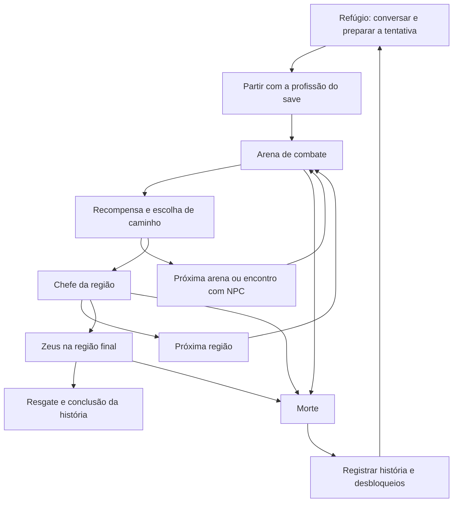

# Design do jogo — versão completa

Documento de trabalho iniciado em 07/10/2026. As decisões confirmadas vêm da
conversa com o autor; propostas de conteúdo e números servem para discussão e
playtests. Este documento descreve a campanha planejada, ainda em desenvolvimento.

## Decisões confirmadas

| Tema | Direção escolhida |
| --- | --- |
| Gênero | Roguelite 2D de hordas, com progressão narrativa |
| Referências | Combinações de poderes e hordas; travessia por fases, NPCs e chefes |
| Combate principal | Mira pelo mouse e ataques da arma escolhida ao segurar o botão esquerdo |
| Protagonista | Um mortal comum que decide enfrentar os deuses |
| Motivação | Resgatar a esposa, raptada por Zeus para ser sua concubina |
| Jornada | Buscar um item ou poder no submundo e alcançar o Olimpo |
| Desfecho principal | Confrontar Zeus e completar a história |
| Tom | Sátira, humor leve e ação frequente |
| Estrutura de tentativa | Percorrer a jornada inteira, com duração aproximada de 30–40 minutos |
| Morte | Reiniciar a jornada, preservando avanços de história e desbloqueios |
| Melhoria da forja | Permanente no personagem, incluindo raridade, bônus e poder após morte e entre runs |
| Material da forja | Uma unidade por andar/região por save; estoque e região premiada persistem entre runs |
| Profissão com muita sorte | Usa somente socos; sorte favorece drops, eventos e dádivas superiores |
| Categorias de dádivas | Comum, Rara, Épica e Mitológica conforme a força dos efeitos |
| Explicação do retorno | Zeus amaldiçoa o protagonista para prolongar o sofrimento; ele aproveita o retorno após a morte para continuar a busca |
| Dificuldade do personagem | Fácil, Média ou Difícil, escolhida e fixada na criação do save; maior desafio dá melhores recompensas |
| Nova profissão Épica | Fazendeiro: ancinho em estocada e troca para foice com corte circular completo |
| Acesso ao Fazendeiro | Desafio de NPC com probabilidade de encontro por run |
| Dádivas por andar | Mais opções gerais e ao menos uma exclusiva de cada região |
| Apresentação | HUD essencial com barra de XP, nova tipografia, diálogos com retratos, sprites/animações próprios para classes, inimigos e poderes |

Essas novas direções foram confirmadas em 13/10/2026. O M1 foi implementado
em 14/10/2026: HUD essencial, visibilidade sonora do Carrasco, revisão do Guardião
e métricas do encontro. O M2 também está implementado: dificuldade fixa e moedas
por modo. O M3 piloto entrou em 15/10/2026 com fontes, sprites direcionais,
efeitos e conversa com retrato de Caronte. M4–M7 continuam planejados.
A dificuldade fixa e o desbloqueio por NPC foram esclarecidos pelo autor.
Multiplicadores iniciais estão em [MARCO_2_DIFICULDADES_E_ECONOMIA.md](MARCO_2_DIFICULDADES_E_ECONOMIA.md).
Conteúdo da missão, efeitos e direção artística final continuam
propostos no [roteiro de melhorias](ROTEIRO_DE_MELHORIAS.md).

Os 30–40 minutos são uma meta para uma tentativa bem-sucedida. Tentativas que
terminam em morte podem ser curtas. Conversas opcionais, pausa e escolhas podem
alongar o tempo real da sessão. A campanha termina por cumprir seus objetivos e
derrotar o chefe final; a duração não concede vitória automaticamente.

## Experiência pretendida

O protagonista usa poderes emprestados, itens e rivalidades divinas para atravessar
o caminho até Zeus. A força cresce durante cada tentativa, mas o mortal continua
dependendo de suas escolhas, da mira e do posicionamento para vencer.

A história avança mesmo após derrotas: NPCs reconhecem encontros anteriores,
informações descobertas continuam disponíveis e novas possibilidades são abertas.
Uma tentativa seguinte deve oferecer tanto uma nova combinação de poderes quanto
uma chance de descobrir algo sobre os personagens e o resgate.

## Ciclo de uma tentativa

O retorno após a morte acontece no refúgio. A explicação escolhida é uma maldição
de Zeus, criada para fazer o protagonista sofrer eternamente com a perda da esposa.
O protagonista aproveita esse retorno para tentar novamente, aprender e conseguir
novos recursos e aliados. Os NPCs lembram dos encontros entre tentativas.

O item ou poder procurado no submundo continua tendo lugar na história: sua função
proposta será ajudar a enfrentar os deuses ou compreender a maldição. Seu efeito
exato ainda será discutido.

## Progressão durante a tentativa e entre tentativas

| Elemento | Ao passar para a próxima arena | Após morrer e iniciar outra tentativa |
| --- | --- | --- |
| Nível, XP e dádivas escolhidas | Mantidos | Reiniciados |
| Vida e estado de combate | Mantidos; descanso pode oferecer recuperação | Reiniciados conforme os atributos iniciais |
| Itens temporários e consumíveis | Mantidos | Reiniciados |
| Moeda para compras da tentativa | Mantida | Reiniciada; regra exata ainda a definir |
| Profissão e arma inicial | Fixas para o save; Fazendeiro poderá alternar suas duas ferramentas | Mantidas; outra profissão exige outro save |
| Dificuldade implementada | Fixa para o save, sem troca no meio da tentativa | Mantida; personagens antigos assumem Média |
| Desafio do NPC do Fazendeiro | Condições ainda propostas; progresso deverá ter regra de persistência explícita | Desbloqueio concedido é permanente; persistência da missão incompleta a confirmar |
| Armas futuras desbloqueadas | Disponíveis conforme as regras da profissão | Permanecem disponíveis; catálogo e regras ainda a definir |
| Informações e eventos de história | Mantidos | Permanecem registrados |
| Óbolos e atributos comprados no refúgio | Atributos mantidos; Óbolos da travessia guardados no retorno | Saldo e compras preservados |
| Relações e encontros com NPCs | Atualizados pelos eventos | Memória dos encontros preservada |
| Fragmentos de Forja | Guardados imediatamente no save | Mantidos até gastar |
| Região que já concedeu fragmento | Bloqueada no save | Continua bloqueada mesmo após gastar; outra região tem limite próprio |
| Raridade/poder da arma forjada | Mantidos | Mantidos permanentemente no save |
| Arena e caminho em andamento | A tentativa continua | A travessia começa novamente |

O autor confirmou atributos permanentes comprados no refúgio, separados das
dádivas que reiniciam. O protótipo usa Óbolos e fontes/custos provisórios:
abates, chefe, baús e um presente inicial de Caronte. Há cinco níveis por atributo
para limitar crescimento. A economia e o balanceamento ainda precisam de playtests.

O autor também pediu baús aleatórios durante a tentativa, com cura e benefícios.
O protótipo oferece vida, XP, estamina e Óbolos em locais alcançáveis. Regras:
[REFUGIO_E_PROGRESSAO.md](REFUGIO_E_PROGRESSAO.md). Desbloqueios de armas, itens e
outras opções permanentes continuam em discussão.

## Proposta de regiões para a primeira campanha

| Região | Função na jornada | Duração ativa proposta, incluindo seu chefe |
| --- | --- | --- |
| Submundo | Conhecer aliados, buscar o poder e aprender as escolhas de caminho | 9–12 min |
| Ascensão ao Olimpo | Explorar rivalidades, combinar poderes e enfrentar ameaças mais complexas | 9–12 min |
| Olimpo | Enfrentar as consequências das escolhas e chegar ao confronto com Zeus | 12–16 min |

Total proposto: 30–40 minutos de combate e travessia. Nomes finais, quantidade de
arenas, chefes intermediários e distribuição de encontros ainda serão definidos.

Como ponto de partida, cada região terá arenas conectadas, uma área de descanso
ou encontro e um chefe principal. Rotas alternativas devem mudar as recompensas
e o risco da tentativa, mantendo sua duração dentro de uma faixa semelhante.

A primeira versão comercial proposta terá três regiões e três chefes principais,
incluindo Zeus. Esse recorte é uma proposta de escopo, ainda sujeita à discussão.

## Regras de combate confirmadas nesta revisão

- A geração por fase será contínua, aleatória ou em hordas do mesmo tipo, sem
  uma quantidade total fixa de inimigos nem prazo de encerramento.
- Cada tipo dará XP específico conforme sua dificuldade: valores iniciais de
  1 para comum, 2 para rápido e 5 para tank, sujeitos a balanceamento.
- Liberar acesso ao chefe exige todas as metas de abate por tipo. Exemplo escolhido:
  40 comuns, 30 rápidos e 8 tanks. Um tipo não compensa a meta de outro.
- O jogador poderá seguir assim que cumprir as metas, com inimigos ainda vivos.
  Não precisa localizar ou eliminar inimigos fora da tela.
- Inimigos devem contornar estruturas para continuar perseguindo o jogador.
- Na criação de um save, o narrador pergunta a profissão uma única vez. Ela muda
  a arma e as bases de atributos: arco, espada, pistola ou socos no protótipo. Outra
  profissão exige outro save. Caçador, Ferreiro, Vigilante, Apostador, Feiticeira, Sacerdote, Necromante e Guerreiro
  são profissões implementadas com nomes/valores provisórios.
- O Apostador luta com socos em um alvo e tem sorte elevada. O protótipo usa 4×,
  favorecendo material, encontro com ferreiro e categorias superiores de dádivas.
- Dádivas têm categorias Comum, Rara, Épica e Mitológica conforme seu poder, com
  pesos distintos no sorteio. São categorias de efeitos, separadas dos níveis de repetição.
- Dádivas de atributos base e compras permanentes usam percentuais sobre as bases
  da profissão, preservando dano fracionário. Bônus de XP, cura e poderes específicos
  mantêm suas regras próprias.
- Uma dádiva temporária de ímã facilita a coleta dos cristais de XP.
- Vida e dano dos inimigos crescem linearmente pelo tempo total da tentativa e
  pela dificuldade da sala; o dano já causado aos inimigos é preservado.

## Combate, itens e encontros

Manter a arma principal com mira manual. Dádivas automáticas, como a aura de
Poseidon e a Égide já existentes, compõem a construção do personagem. A combinação
entre arma, poderes, dash e posicionamento deve ser o centro do combate.

Propostas para as arenas:

- Cumprir metas de abate por tipo, liberando a passagem sem encerrar as hordas pelo relógio.
- Eliminar um inimigo de elite enquanto controla a horda.
- Escolher um desafio opcional para obter uma recompensa melhor.
- Derrotar um chefe com ataques sinalizados, intervalos de reação e fases próprias.

Ao concluir uma arena, permitir recolher as recompensas antes de sair. Evitar que
a mudança de fase descarte experiência sem que o jogador compreenda a consequência.

Itens temporários podem modificar ataques ou oferecer recursos limitados; armas
e artefatos narrativos podem ter desbloqueios permanentes. O catálogo e seus efeitos
serão definidos após validar a primeira região.

NPCs devem oferecer consequências jogáveis: informação, troca, favor, desafio ou
uma escolha que altere a rota. Conversas principais serão curtas, em locais seguros,
com detalhes opcionais para quem quiser explorar mais a história.

## Variedade entre tentativas — desenvolvimento futuro

O autor pediu diferenças de gameplay entre runs para sustentar a vontade de
repetir. O encontro com o Ferreiro Errante foi implementado: 3% base por tentativa,
material persistente com 1,5% base por mini-boss e forja permanente. O mini-boss
tem giro e pedras, sem ataque de movimento, entre hordas. O limite é um fragmento
por região por save, mesmo após gastar, morrer ou repetir a região.
O Apostador tem sorte 4× e dádivas superiores mais frequentes; a seleção por
categorias já cria diferenças entre runs. Regras:
[FERREIRO_E_MINI_BOSS.md](FERREIRO_E_MINI_BOSS.md) e
[SORTE_E_RARIDADE.md](SORTE_E_RARIDADE.md).

Cinzas oferece um baú de recuperação/moeda; Sombras oferece uma dádiva extra
Rara ou superior. Cada sala sorteia um evento de hordas, mantido ao reabrir a rota
e apresentado antes da entrada. O protótipo registra a forja permanentemente no save.
Regras: [ROTAS_DO_SUBMUNDO.md](ROTAS_DO_SUBMUNDO.md).

Os sistemas abaixo permanecem como propostas de conteúdo:

- Encontros sorteados com NPCs, escolhas e efeitos no caminho ou nas recompensas.
- Ampliar as recompensas e desafios próprios das rotas, a partir de Cinzas e Sombras.
- Ampliar os eventos de hordas com modificadores de arena e inimigos de elite que
  exijam mudar o posicionamento.
- Sinergias e condições nas dádivas que favoreçam construções diferentes dentro
  da mesma profissão, já que ela permanece fixa para o personagem.
- Eventos narrativos que abram novas possibilidades conforme o progresso do save.

Testar se o encontro com o ferreiro, as recompensas distintas e os eventos mudam
as decisões na primeira região e só então ampliar o catálogo. Variedade precisa oferecer
escolhas com consequências; trocar cores ou aumentar números tem alcance limitado.

## Direção narrativa proposta

O humor pode surgir da vaidade dos deuses, de disputas de prestígio, de favores
cobrados e da indignação prática do protagonista. Sua jornada cresce de uma
questão pessoal até um conflito com a organização do Olimpo.

### Maldição de Zeus e encontros com Caronte

A premissa da maldição foi escolhida pelo autor. Zeus pretende perpetuar o sofrimento
do marido; a persistência do mortal transforma o castigo em oportunidades para
desafiar o próprio Zeus. O motivo dos retornos deve aparecer cedo, para o jogador
compreender a ligação entre história e repetição das tentativas.

Regras propostas para desenvolver essa premissa:

- O protagonista ainda sofre dano, perde combates e morre. A maldição o faz retornar.
- O crescimento entre tentativas vem de aprendizado, desbloqueios e relações,
  com regras próprias para recursos permanentes. Evitar bônus infinitos por morrer.
- Cada retorno começa uma nova travessia; os poderes temporários serão reconstruídos.
- Zeus percebe gradualmente que o castigo está ajudando seu adversário.
- Definir o que impede Zeus de simplesmente revogar a maldição ao perceber o risco.
  Uma possibilidade é um juramento divino com condições e consequências próprias;
  essa regra seria uma criação do jogo, inspirada na mitologia.

O autor sugeriu uma interação cômica em que o protagonista tenta subornar Caronte.
Ela pode virar um encontro recorrente, com falas que mudam conforme as tentativas,
a relação com o barqueiro e o avanço até o Olimpo. Mecânicas de desconto, favores
ou trocas continuam como possibilidades a discutir.

Exemplo de diálogo original, ainda não aprovado como roteiro:

> **Protagonista:** Te dou uma moeda se você me devolver vivo.
>
> **Caronte:** Você já vai ser devolvido vivo.
>
> **Protagonista:** Então me devolve perto do Olimpo.
>
> **Caronte:** Uma moeda compra uma travessia, não uma mudança de endereço.

### Inspiração mitológica

A premissa funciona como adaptação satírica. Na *Teogonia*, Hesíodo descreve a punição
de Prometeu imposta por Zeus, com o fígado regenerando após ser devorado pela águia.
Isso oferece referência para sofrimento repetido sustentado por uma condição divina.
[Teogonia, trecho iniciado no verso 507](https://www.theoi.com/Text/HesiodTheogony.html).

No *Hino Homérico a Afrodite*, Zeus concede imortalidade a Titono a pedido de Eos,
que não pede também juventude permanente. É uma referência para poder divino e
uma existência prolongada com consequências indesejadas.
[Hino Homérico a Afrodite, versos 218–238](https://chs.harvard.edu/primary-source/homeric-hymn-to-aphrodite-sb/).

Caronte aparece como barqueiro em *As Rãs*, comédia de Aristófanes, e cobra a travessia
de Dioniso. A obra oferece uma referência antiga para o uso cômico desse encontro.
[As Rãs](https://classics.mit.edu/Aristophanes/frogs.html).

Essas referências não descrevem a maldição do protagonista. O retorno após a morte,
suas condições e a tentativa de suborno serão criações deste jogo.

Propostas a discutir:

- A esposa tem personalidade própria e participa do resgate, descobrindo informações
  ou sabotando planos enquanto o protagonista tenta alcançá-la.
- Aliados divinos ajudam por interesses próprios, com dádivas ou pedidos que
  influenciam o combate e o caminho.
- NPCs mudam suas falas conforme encontros, chefes enfrentados e descobertas.
- A maldição de Zeus permite repetir as regiões e enfrentar chefes enquanto
  as relações e informações da história continuam avançando.
- A primeira vitória conclui o resgate; o formato das tentativas posteriores
  e de eventuais desafios extras será decidido depois.

Nomes finais das profissões, personalidade da esposa, diálogos e detalhes
da conclusão ainda estão abertos. As propostas acima não são roteiro aprovado.

## Próximo marco: uma região completa

Construir primeiro uma travessia curta no submundo para validar o ciclo da campanha.
Recorte proposto: três arenas de combate, um encontro seguro, dois NPCs e um chefe.
A quantidade de arenas poderá mudar ao medir a duração e o ritmo.

Critérios de conclusão:

- [x] Começar no refúgio e preparar uma tentativa.
- [x] Escolher profissão uma única vez por save e manter personagens independentes.
- [x] Aplicar bônus percentuais às bases das profissões, ímã de XP e escala linear dos inimigos.
- [x] Oferecer socos com sorte elevada, raridades de dádivas e limite regional persistente de material.
- [x] Introduzir Feiticeira, Sacerdote, Necromante lendário e Guerreiro com defesa/revide.
- [x] Combinar choque, queimadura, impacto e aura com recargas próprias.
- [x] Introduzir Arqueiro do Estige com aviso de mira fixa, flechas bloqueáveis e XP/Almas próprios.
- [ ] Validar leitura e equilíbrio do inimigo à distância nas oito profissões em travessias completas.
- [x] Gerar Fúria dos Deuses por farming após a saída liberada, com aviso e escala pela build.
- [ ] Validar ao menos três combinações viáveis e economia do desbloqueio lendário em partidas completas.
- [x] Atravessar arenas com objetivos e saídas claramente apresentados no protótipo.
- [x] Escolher entre acesso direto ao chefe e combates opcionais com metas e intensidade diferentes.
- [x] Acrescentar recompensas próprias às rotas: baú em Cinzas e dádiva Rara ou superior em Sombras.
- [x] Variar a composição das hordas por tentativa e anunciar os eventos na escolha de caminho.
- [ ] Ampliar desafios opcionais e validar o valor de cada rota em playtests.
- [x] Preservar vida, XP, nível, dádivas, estamina e recargas ao mudar de arena.
- [ ] Introduzir inventário temporário e preservá-lo nas transições.
- [x] Interagir com Caronte e o Ferreiro Errante, com presente, eventos e melhoria permanente da arma.
- [x] Enfrentar um chefe com ataques sinalizados e vitória por derrota do chefe no protótipo.
- [x] Morrer, retornar ao refúgio e iniciar outra tentativa com o estado temporário limpo.
- [x] Preservar uma compra permanente e eventos de Caronte após morrer e após fechar o jogo.
- [x] Oferecer baús aleatórios com suprimentos durante a tentativa.
- [x] Receber o primeiro parecer do autor em partidas práticas.
- [ ] Validar a travessia inteira na matriz de profissões, dificuldades e progressão.
- [x] Aplicar o HUD essencial, regra sonora de visibilidade e ajuste do Guardião.
- [ ] Validar a dificuldade/ritmo do Guardião revisado em partidas completas.
- [ ] Incorporar Fazendeiro/NPC de desafio, dádiva regional e novas compras do altar.
- [ ] Revisar tipografia, conversas, sprites e animações da região completa.

## Ordem de implementação

Ordem revisada após os playtests de 13/10/2026. A base funcional das etapas
anteriores permanece registrada no plano de lançamento; os próximos marcos são:

| Etapa | Entrega | Verificação principal |
| --- | --- | --- |
| M1 — implementado; playtests pendentes | HUD essencial, áudio do mini-boss e chefe mais exigente | Barra de XP/Tab, visibilidade por máscara/câmera, padrões variados e novas métricas |
| M2 — implementado; playtests pendentes | Três dificuldades fixas por save | Migração para Média, moedas fracionárias e modos distintos; 222 testes/OpenGL |
| M3 — piloto implementado; revisão do autor pendente | Base visual e conversa piloto | Noto Sans/Cinzel, atlas, caminhada direcional e Caronte; 228 testes/OpenGL |
| M4 | Catálogo de dádivas e altar | Seis gerais + uma regional e três compras como primeiro lote proposto |
| M5 | Desafio de NPC e Fazendeiro Épico | Encontro por run, progresso/recompensa persistentes e duas ferramentas úteis |
| M6 | Arte de toda a primeira região | Classes/inimigos distintos, VFX por sprites e direção suave |
| M7 | Fechar região e preparar expansão | Variedade/narrativa, playtests, produção das regiões seguintes e Zeus |

Critérios completos e decisões ainda abertas: [ROTEIRO_DE_MELHORIAS.md](ROTEIRO_DE_MELHORIAS.md).

O estado da tentativa será responsável por nível, poderes, inventário e caminho
atual. O perfil persistente guardará desbloqueios e eventos narrativos. Cada arena
terá suas entidades e recursos gráficos, que serão liberados na transição.

Salvar para interromper e retomar uma tentativa é uma funcionalidade proposta,
separada da regra de morte. Definir quando e como o jogo será salvo antes de
implementá-la; morrer deve concluir a tentativa em andamento.

O Arqueiro do Estige acrescenta pressão à distância às hordas, preservando as
metas de comuns, rápidos e tanks. Regras e matriz de partidas das oito profissões:
[ARQUEIRO_DO_ESTIGE.md](ARQUEIRO_DO_ESTIGE.md). A verificação automática já passou;
os testes manuais de equilíbrio continuam pendentes.

## Decisões ainda abertas

- Ajustes dos multiplicadores iniciais após partidas; regras implementadas no M2.
- Identidade/chance do NPC, condições/persistência do desafio e escopo compartilhado do acesso ao Fazendeiro.
- Bases, alcance, recarga de troca e poder de forja de ancinho/foice.
- Novas dádivas gerais/regionais e limites/preços do altar.
- Revisão do estilo piloto em escala real antes de expandir a arte do elenco.

- Condições da maldição, impedimento para Zeus revogá-la e seu estado após o resgate.
- Função do item ou poder buscado no submundo.
- Identidade dos primeiros aliados e do chefe do submundo.
- Quais escolhas de dádivas envolvem custos, rivalidades ou condições.
- Nome final da moeda, fontes, custos e balanceamento das melhorias permanentes.
- Interrupção e retomada de uma tentativa ao fechar o jogo.
- Conteúdo disponível após completar a história pela primeira vez.

## Relação com o projeto atual

A versão jogável atual oferece a demo de sobrevivência e um protótipo separado da
campanha, descritos no [README](../README.md). A campanha já tem estado de tentativa,
arenas conectadas, profissões, armas, metas de abate, seleção de destino e combate
com o Guardião do Tártaro. As definições das arenas estão em JSON;
a [documentação técnica](CAMPANHA_TECNICA.md) explica como ampliar o percurso.

O Guardião é um chefe provisório com quatro padrões sinalizados e segunda fase;
sua identidade final continua aberta. As regras estão em [CHEFE_DO_SUBMUNDO.md](CHEFE_DO_SUBMUNDO.md).
Os nomes e metas das arenas são provisórios; a fase não termina por tempo.
Refúgio, Caronte, loja de atributos permanentes, baús e perfil salvo foram
acrescentados. Saves independentes, profissão fixa, ímã e balanceamento por
percentuais estão em [BALANCEAMENTO_E_SAVES.md](BALANCEAMENTO_E_SAVES.md).
Ferreiro, mini-boss, forja, limite por região, quarto save, Apostador e categorias
ponderadas de dádivas foram acrescentados. Sorte e probabilidades estão em
[SORTE_E_RARIDADE.md](SORTE_E_RARIDADE.md). Outros encontros, inventário geral
e novas formas de variar as tentativas continuam planejados. Recompensas próprias
nas rotas, eventos de hordas e forja permanente já estão em
[ROTAS_DO_SUBMUNDO.md](ROTAS_DO_SUBMUNDO.md);
Novas classes, sinergias e Fúria dos Deuses estão em
[CLASSES_SINERGIAS_E_DESTINO.md](CLASSES_SINERGIAS_E_DESTINO.md).
A primeira região tem áudio/feedback provisórios com volumes persistentes.
Ainda precisa de revisão sonora, arte e playtests. Origem e critérios:
[AUDIO_E_FEEDBACK.md](AUDIO_E_FEEDBACK.md).

Os requisitos de qualidade e publicação permanecem no
[plano de lançamento](PLANO_DE_LANCAMENTO.md).

## Resumo e progressão compartilhada implementados

O Necromante passou a custar **1.000 Almas** de um saldo compartilhado entre os
oito saves, conforme decisão de 12/10/2026. Óbolos, atributos, arma e materiais
continuam pessoais. Ganhos por derrotas são guardados ao retornar; acessos lendários
antigos são preservados. O resumo por R mostra salas, poderes, dano efetivo,
causa da morte e moedas, com histórico recente para orientar playtests.
Regras e valores: [ALMAS_E_RELATORIOS.md](ALMAS_E_RELATORIOS.md).
